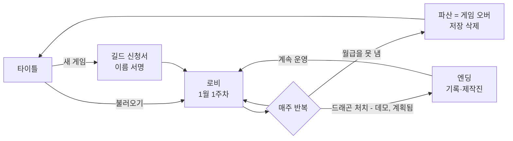
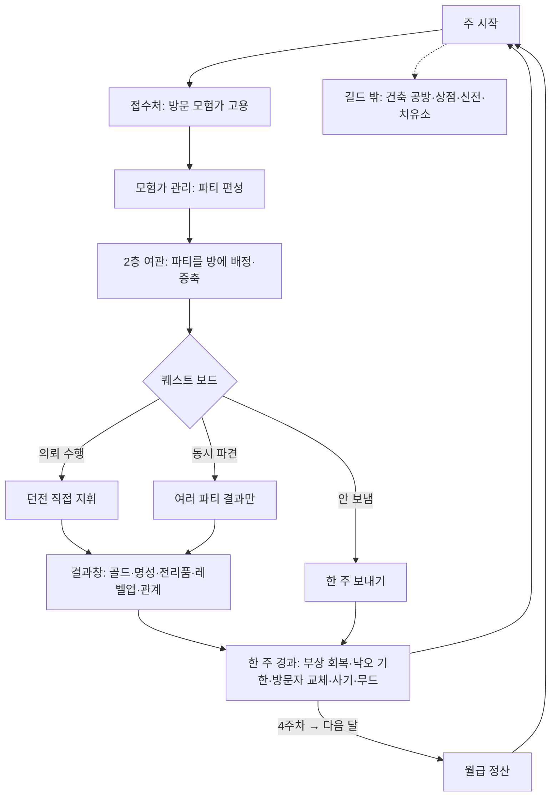
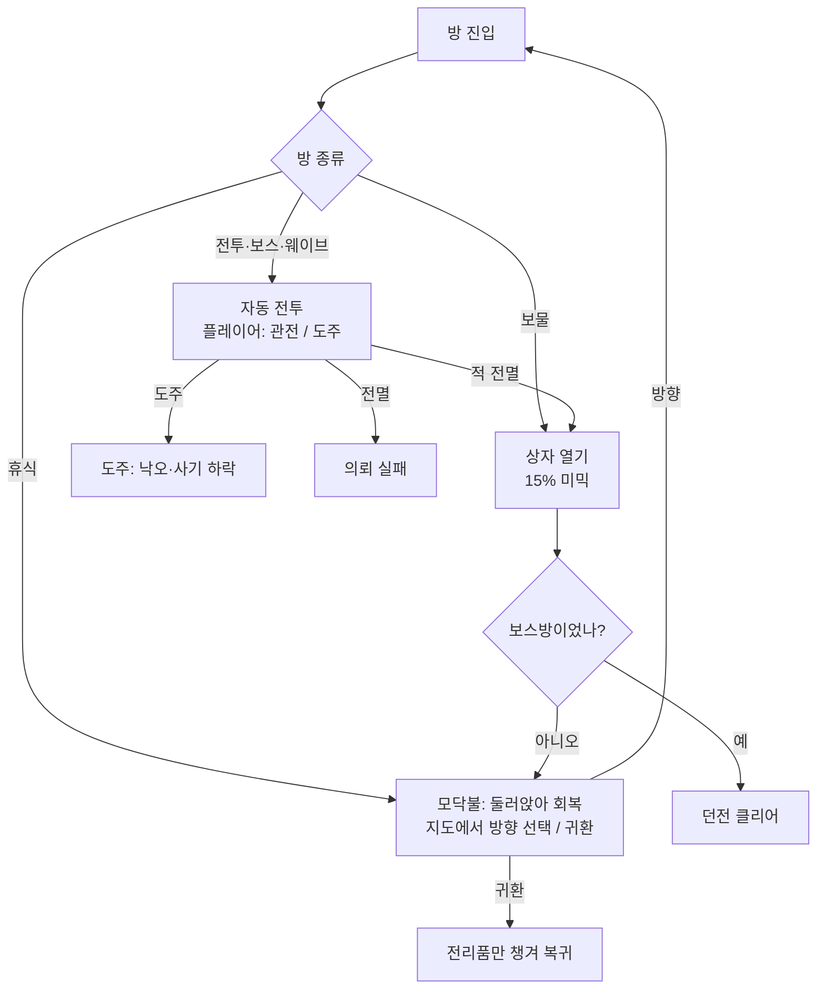
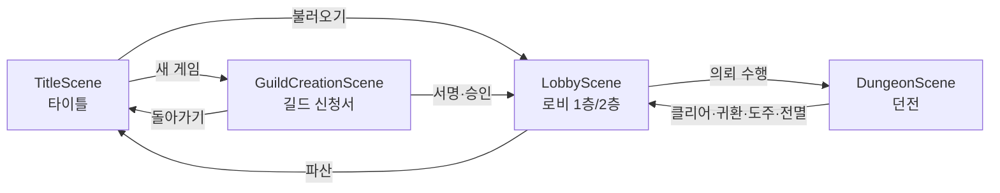
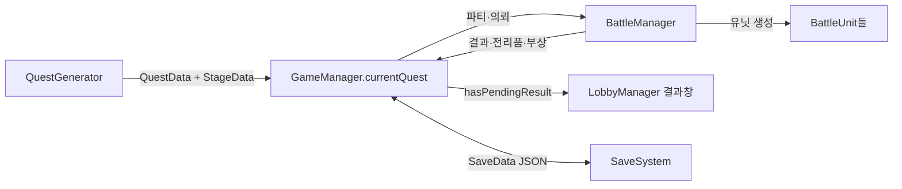

# 게임 기획서 (GDD) — 프로젝트 길드 매니저

| 항목 | 내용 |
|---|---|
| 문서 버전 | v2.2 (v2.0 = 2026-02-25판 8쪽 기획서 `길드 매니저.pdf`를 현재 구현 기준으로 전면 개정 / v2.1 = 13.4 질문에 대한 사용자 결정 반영 / v2.2 = 후속 질문 답 반영, 데모 엔딩·동시 파견 차별화·장비 1차 구현) |
| 작성일 | 2026-10-20 |
| 기준 시점 | **git 저장소가 아니므로 커밋 해시 없음.** 기준 = `Docs/작업일지_2026-10-19.md` + 2026-10-20 세션 작업(튜토리얼·타이틀·길드 신청서·구멍 길찾기·근접 제한·모닥불 둘러앉기·앉기 동작·밸런스 결정 3건·하드코딩 수치 설정 이전) |
| v2.2 변경 | 데모 엔딩(드래곤 처치, 직접 지휘만)·동시 파견 차별화(보상 80%·경험치 70%·실패 위험 상향)·장비 1차(무기·방어구·강화) **구현**, 탱커 의존 해법 결정(13.4 E), 목표 승률 숫자 확정(6.1) |
| v2.1 변경 | 데모/정식 엔딩, 타깃 유저, 장비·강화 도입, 6명 파티 견제 안 함, 지역 목표 난이도, 동시 파견 차별화, 스토리·사운드는 정식 출시 때, 하드코딩 수치 설정 이전(완료). 결정 원문은 13.4 |
| 엔진 | Unity 6000.3.2f1, 2D URP 17.3.0, 새 Input System 1.17.0 |
| 작성 원칙 | 모든 항목은 아래 근거 파일에서 확인한 내용만 적음. 상태 태그를 붙임 |

### 상태 태그

| 태그 | 뜻 |
|---|---|
| **[구현됨]** | 코드·씬·프리팹에서 동작을 확인할 수 있음 (근거 경로 표기) |
| **[계획됨]** | 기존 기획서·메모·작업일지에 언급됐지만 아직 없음 |
| **[추정]** | 코드 구조로 유추함 (이유 한 줄) |
| **[미정]** | 근거가 없어 결정이 필요함 |
| **[불일치]** | 코드와 문서(메모·기존 기획서·CLAUDE.md)의 내용이 서로 다름. 양쪽을 모두 적음 |
| **[임시값]** | 구현돼 있지만 작업일지에 "제가 정함 / 임시"로 남은 수치. 사용자 확인 전 |

### 근거로 사용한 파일

- **기존 기획서**: `길드 매니저.pdf` 2026-02-25판 (프로젝트 밖 원본, 8쪽, 텍스트 추출로 확인)
- **프로젝트 문서**: `CLAUDE.md`, `Docs/작업일지_2026-10-13_14.md`, `작업일지_2026-10-14_15.md`, `작업일지_2026-10-15_16.md`, `작업일지_2026-10-17_18.md`, `작업일지_2026-10-19.md`, `Docs/특성_목록_2026-10-18.txt`, `특성_목록_2026-10-19.txt` (`Docs/특성.txt`는 빈 파일)
- **작업 메모(Claude 메모리)**: `MEMORY.md`, `project_gdd_status.md`, `project_next_session_handoff.md`, `project_changes_20260917.md`, `project_enemy_stats_rollback.md`, `project_tutorial.md`, `project_floor_pathing.md`, `feedback_vertical_slice_first.md`, `reference_gdd.md`, `reference_unity_mcp_quirks.md`, `user_profile.md`
- **코드**: `Assets/Scripts/` 전체 (Managers 7, Core 37, Runtime 30여 개, AI 40여 개, Data, Props, UI Scripts) — 주요 파일은 각 절에 표기
- **데이터**: `Assets/Prefabs/Characters/*.prefab`(30개 직렬화 스탯), `Assets/Data/Drops/Item_*.asset`(13종 가격), `Assets/Scenes/*.unity`(GameManager·QuestGenerator·BattleManager 직렬화 값), `Packages/manifest.json`, `ProjectSettings/ProjectVersion.txt`
- **TODO/FIXME**: 코드 전체에서 2건 (`LobbyManager.cs:723`, `UI Scripts/DispatchPopup.cs:75` — 쓰이지 않는 옛 화면)

> 씬에 저장된 값과 코드 기본값을 비교했고, GameManager·QuestGenerator·BattleManager의 주요 수치는 모두 같았습니다(다른 곳은 본문에 표시).

---

## 목차

1. 개요
2. 디자인 기둥
3. 핵심 게임플레이 루프
4. 조작 및 플레이어 시스템
5. 게임 시스템 상세
6. 콘텐츠
7. 진행 및 경제
8. 세계관·내러티브
9. UI/UX
10. 아트·사운드 방향
11. 기술 구조
12. 개발 현황 및 로드맵
13. 미결 사항 및 리스크
부록 A. 기존 기획서(2026-02) 대비 변경 요약

---

## 1. 개요

| 항목 | 내용 | 상태 |
|---|---|---|
| 제목 | 프로젝트 길드 매니저 (가제). 게임 안 로고는 "길드 매니저 / GUILD MANAGER" | [구현됨] `Tools/title_art_gen.py`, TitleScene |
| 장르 | 2D 파티 육성 + 길드 경영 + 자동 전투 RPG (오토배틀러) | [구현됨] |
| 플랫폼 | PC (마우스 포인트 앤 클릭, 1920×1080 기준 UI) | [구현됨] 기준 해상도 / 기존 기획서 0장 |
| 엔진 | Unity 6 (6000.3.2f1), 2D URP, 단일 어셈블리 | [구현됨] |
| 벤치마킹 | 팀 파이트 매니저(전투 방식) | 기존 기획서 0장 |
| 타깃 유저 | 매니지먼트 게임을 좋아하는 유저, 게임에 몰입하는 것을 좋아하는 유저 | 사용자 결정 (2026-10-20) |
| 출시 형태 | **데모 버전**(현재 범위 + 드래곤 처치 엔딩) → **정식 버전**(경쟁 길드·스토리·사운드 추가) | 사용자 결정 (2026-10-20) |
| 플레이어 역할 | 모험가 길드의 운영자(길드 마스터). 직접 싸우지 않음 | [구현됨] 튜토리얼 문구 `Core/TutorialRules.cs` |

**엘리베이터 피치**
> 성격과 관계를 가진 모험가들을 고용해 파티를 짜고, 지역별 던전으로 보내 자동 전투를 지켜보며 "더 갈지, 돌아갈지, 도망칠지"를 판단한다. 벌어 온 골드로 매달 월급을 주며 길드를 키우고, 명성을 쌓아 더 위험한 지역을 연다. 잘못 판단하면 모험가는 다치고, 낙오하고, 죽는다.

---

## 2. 디자인 기둥

기존 기획서 1장의 "핵심 재미" 네 줄과, 그 뒤 사용자가 내린 결정들의 공통된 방향으로 정리했습니다. **[추정]** (기둥이라는 이름으로 명시된 문서는 없음)

| # | 기둥 | 근거가 되는 구현 |
|---|---|---|
| 1 | **사람을 운영한다** — 모험가는 숫자가 아니라 성격·특성·관계·상처를 가진 사람 | 성격 13종, 특성 12종, 트라우마·결함 9종, 관계 5종, 무드, 케미 (5.3~5.6) |
| 2 | **관전하고 판단한다** — 전투는 자동, 플레이어의 몫은 위험 판단 | 도주·모닥불 귀환·방향 선택, 파견 위험 경고, 낙오·사망·유해 수습 (5.9~5.12) |
| 3 | **살림이 빠듯하다** — 매달 월급, 못 내면 파산 | 월급 정산과 파산, 전리품 판매, 시설·방 증축 투자 (7장) |

- 개발 우선순위 원칙: "디테일(밸런스·드랍·전용 스크립트)보다 핵심 루프가 끝까지 도는 버티컬 슬라이스가 먼저" (2026-10-11 사용자 지시, 메모 `feedback_vertical_slice_first.md`).

---

## 3. 핵심 게임플레이 루프

### 3.1 세션 단위 (한 판 = 길드 하나)



- 시작: 골드 1000, D랭크 모험가 4명(전사·마법사·도적·사제), 명성 0. [구현됨] `GuildCreationManager.cs`, `GameManager.GrantStarterAdventurers`
- 끝: **파산만 있음.** 월급 정산 뒤 골드가 0 미만이면 게임 오버, 저장 파일 삭제. [구현됨] `GameManager.MonthlySettlement`, `TriggerGameOver`
- 승리 조건·엔딩 (사용자 결정 2026-10-20):
  - **데모 버전: 드래곤 처치.** [구현됨] (2026-10-20) 아래 표.
  - **정식 버전: 경쟁 길드들 사이에서 명성이 가장 높은 길드가 되는 것.** [계획됨] 경쟁 길드는 아직 설계 없음.

**데모 엔딩** [구현됨] `Core/GuildRecordRules.cs`, `Runtime/EndingScreen.cs`, `BattleManager.RecordResultAndEnding`, `GameManager.ReserveDemoEnding`, `Tools > 데모 엔딩 연결`

| 항목 | 내용 |
|---|---|
| 조건 | **직접 지휘**로 어른 드래곤(`Enemy_Dragon`) 보스를 쓰러뜨리고 의뢰에 성공(귀환·재료·구출 완료 후 도주 포함). 새끼 드래곤은 해당 없음. **동시 파견으로는 엔딩 없음** (사용자 결정) |
| 연출 | 로비로 돌아오면 엔딩 화면: 어둠 속 불티 → 쓰러지는 드래곤 → "드래곤 토벌" 제목 → 살아 돌아온 파티가 걸어 들어옴 → 이번 길드의 기록 → 감사 인사. 화면을 누르면 건너뜀 |
| 기록 | 걸린 기간(몇 월 몇 주, 총 주 수), 고용한 모험가 수(+창립 멤버), 의뢰 성공/실패(직접 지휘·동시 파견·귀환 포함), 최종 골드·명성, 소속 모험가 수, 잠든 동료(한 번이라도 죽은 이름) |
| 이후 | [계속 운영](저장 유지, 그대로 이어서 플레이) / [타이틀로](저장 후 타이틀) |
| 저장 | 저장 파일에 기록(`GuildRecord`)과 "엔딩 봄"이 남음. 기본 설정은 한 번만 보여 줌(`DemoEndingSettings.repeatAfterSeen`) |

- 조건 보스 이름·반복 여부는 BattleManager 인스펙터 `demoEnding`에서 조정. 화면 확인: 스크린샷으로 확인(10/20).

**정식 버전 경쟁 길드 메모** [계획됨] — 설계 전. 방향만: 다른 길드들도 매주 명성을 얻고, 로비에서 순위를 볼 수 있으며, 명성 1위가 목표. 세부(길드 수·명성 증가 방식·방해/경쟁 요소)는 정식 버전 기획 때 결정.

### 3.2 주 단위 (분 단위 루프, 로비)



- 한 달 = 4주. 결과창 [확인] 또는 [한 주 보내기]로 한 주가 지남. [구현됨] `LobbyManager.AdvanceWeek`, `GameManager.PassWeek`
- 직접 지휘 파견은 한 주에 한 번(결과 확인 시 주가 넘어감). 동시 파견은 여러 파티를 한 번에. [구현됨]

### 3.3 던전 단위 (초 단위 루프)



- 전투 중 유닛 AI: 0.25초마다 대상 재선택 → 성향별 위치 잡기 → 사거리 진입 시 공격 → 마나가 차면 스킬. [구현됨] `AI/BattleUnit.cs`, `Core/CombatPositioning.cs`

---

## 4. 조작 및 플레이어 시스템

플레이어 캐릭터(아바타)는 없습니다. 플레이어 = 길드 마스터의 의사결정입니다.

| 영역 | 조작 | 상태 |
|---|---|---|
| 입력 장치 | 마우스 (새 Input System 전용. 레거시 `Input.*` 사용 불가) | [구현됨] `ProjectSettings activeInputHandler: 1`, 메모 `reference_unity_mcp_quirks.md` |
| 로비 이동 | 시설 오브젝트 클릭(포인트 앤 클릭), 계단으로 1층 ↔ 2층 | [구현됨] `UI Scripts/InteractiveObject.cs`, `Runtime/LobbyFloorSwitcher.cs` |
| 고용 | 접수처 카드를 오른쪽으로 끌면 고용, 왼쪽은 돌려보냄 | [구현됨] `Runtime/ReceptionView.cs`, `SwipeCard.cs` |
| 던전 중 | 직접 조작 없음. [도주] 버튼, 유닛에 마우스를 올리면 상태 말풍선 | [구현됨] `BattleManager.OnClickFleeButton`, `Runtime/UnitHoverTooltip.cs` |
| 모닥불 | 지도에서 방향(북·동·남·서) 버튼, [귀환] | [구현됨] `Runtime/DungeonMapPanel.cs` |
| 툴팁 | 성격·특성·트라우마·관계 이름에 마우스 → 설명 | [구현됨] `Runtime/TextLinkTooltip.cs` |
| 저장 | 자동 저장 1슬롯 (한 주가 지날 때, 로비에서 종료할 때). 파산 시 삭제 | [구현됨] `Managers/SaveSystem.cs`, `GameManager.SaveGame` |
| 키보드 | 타이틀 인트로 건너뛰기에만 사용 | [구현됨] `Runtime/TitleScreen.cs` |

---

## 5. 게임 시스템 상세

각 시스템은 **목적 / 규칙 / 수치 / 연결**로 정리합니다. 수치 뒤 괄호는 출처입니다.

### 5.1 모험가 (직업·스탯·성장)

**목적**: 파티 조합의 재료. 직업이 역할을, 랭크·잠재력이 성장 한계를 정함.

**규칙** [구현됨] `Character Scripts/AdventurerGenerator.cs`, `Core/StatGrowthRules.cs`, `Core/DefenseRules.cs`, `Core/PotentialRules.cs`, `Core/AdventurerLevelRules.cs`

- 직업 5종: 전사 / 마법사 / 궁수 / 도적 / 사제(힐러). 랭크 D~S.
- Lv.1 스탯 = 직업 기본값 × 랭크 배율(1 + 랭크단계×0.5, D=1.0 ~ S=3.0) × 무작위(0.9~1.1).
- 시작 레벨: D·C 1 / B 2~3 / A 4~5 / S 6~8.
- 레벨업 필요 경험치 = 현재 레벨 × 100. 레벨당 성장 = 직업 기본 성장 × (1 + 랭크단계×0.2) × 잠재력 배율. 소수는 다음 레벨업으로 이월.
- 최대 레벨: D 10 / C 15 / B 20 / A 25 / S 30.
- 방어력(모험가만): 받는 피해 × 100 ÷ (100 + 방어력). 출혈·화상은 방어력 무시.
- 치명타·회피: 기본 10% / 10%, 도적 30% / 30%. 레벨업으로 오르지 않음. 치명타는 기본 공격에만, 피해 ×1.5(도적 ×2.0). 적은 치명타·회피 없음.

**수치 — 직업 기본값** (GameManager 인스펙터 `jobStats` = `JobStatSettings`, `DefenseSettings`, 각 `Ally_*.cs`)

| 직업 | Lv.1 HP | Lv.1 공격 | 이동 | 사거리 | 성장 HP/레벨 | 성장 공격/레벨 | 방어 기본 / 레벨당 | 어그로 | 전투 성향 |
|---|---|---|---|---|---|---|---|---|---|
| 전사 | 150 | 12 | 2.0 | 1.1 | 15 | 3 | 15 / +2 | **50** | 수호 |
| 마법사 | 70 | 25 | 2.0 | 5.5 | 7 | 5 | 5 / +1 | 10 | 원거리 |
| 궁수 | 80 | 18 | 2.5 | 6.0 | 8 | 4 | 5 / +1 | 10 | 원거리 |
| 도적 | 60 | 20 | 3.0 | 1.2 | 6 | 4 | 5 / +1 | 10 | 우회 |
| 사제 | 90 | 8 | 2.2 | 4.0 | 9 | 2 | 8 / +1 | 5 | 지원 |

- 방어력 랭크 배율: 기본 × (1 + 랭크단계×0.5), 레벨당 × (1 + 랭크단계×0.2), ±10%. [임시값] (작업일지 10/18 5.1)

**수치 — 잠재력과 성장** (`PotentialSettings`)

| 잠재력 | 1 | 2 | 3 | 4 | 5 |
|---|---|---|---|---|---|
| 레벨당 성장 배율 | ×1.0 | ×1.1 | ×1.2 | ×1.3 | ×1.4 |

- [임시값] 배율(작업일지 10/18 2.8).

**직업 스킬** [구현됨]

| 직업 | 공격 | 스킬 (마나 100이 차면) | 패시브 |
|---|---|---|---|
| 전사 | 초당 0.6회, 베기에 넉백 0.4 / 0.15초 경직 | **방패 막기**: 다음 공격 3회 무효 ("BLOCK") | 받는 피해 −20%, 피격 시 마나 +10 (`Ally_Warrior.cs`) |
| 마법사 | 파이어볼 | **메테오 스트라이크**: 대상 지점 반경 2.0 폭발, 공격력 ×2.5 (`Ally_Mage.cs`) | — |
| 궁수 | 화살 | **화살 연사**: 가장 가까운 적 3명 동시 공격 (`Ally_Archer.cs`) | — |
| 도적 | 초당 3회 | **은신 2초**: 어그로 해제, 은신 중 피해 면역("IMMUNE"), 나타난 첫 공격 확정 치명타 ×2 | 매 방 전투를 3초 은신으로 시작 (`Ally_Rogue.cs`) |
| 사제 | 원거리 4.0, 마나 +25/타 + 초당 10 | **파티 힐**: 다친 아군이 있으면 즉시 아군 전체 공격력 ×2 회복 | 다친 아군이 없으면 마나를 아낌 (`Ally_Healer.cs`) |

- [불일치] 기존 기획서 3.2: 전사 스킬 "강한 베기", 도적 스킬 "후방 타격". → 코드: 전사 "방패 막기"(10/13 교체), 도적 "은신"(10/16 개편).

**연결**: 랭크 → 고용비·월급·회복 비용 / 직업 → 전투 성향(5.8) / 레벨 → 파견 경고(5.11)·동시 파견 전투력(5.12)

### 5.2 고용 (접수처)

**목적**: 모험가 수급. 명성이 오를수록 고랭크가 찾아옴.

**규칙** [구현됨] `Core/RecruitmentRules.cs`, `GameManager.TryHireVisitor`, `Runtime/ReceptionView.cs`

- 매주 방문 모험가가 새로 옴(접수처 Lv1 4명 / Lv2 5명 / Lv3 6명). 고용하지 않으면 다음 주에 떠남.
- 고용비 = 100 + 랭크단계 × 100 (D 100 / C 200 / B 300 / A 400 / S 500 G).
- 정보 공개: 접수처 Lv1 직업·랭크·스탯 / Lv2 성격·특성(+툴팁) / Lv3 잠재력.
- 여관 인원 한도를 넘으면 고용 불가 (최대 모험가 = 8 + (여관 레벨−1) × 4).
- 시작 특성: 고용 시 B 30% / A 60% / S 100% 확률로 일반 특성 1개. 특별 특성 '용사의 기운' A 5% / S 10%, '육감' 10%.

**수치 — 명성별 방문 랭크 가중치** (`RecruitmentSettings.rankTiers`)

| 명성 이상 | D | C | B | A | S |
|---|---|---|---|---|---|
| 0 | 70 | 25 | 5 | 0 | 0 |
| 100 | 55 | 30 | 12 | 3 | 0 |
| 300 | 40 | 30 | 20 | 9 | 1 |
| 600 | 25 | 30 | 25 | 15 | 5 |
| 1000 | 10 | 25 | 35 | 22 | 8 |

**연결**: 명성(7.3) → 방문 랭크 / 여관 레벨 → 인원 한도 / 골드 → 고용비·월급

### 5.3 성격 (13종)

**목적**: 같은 직업도 다르게 행동하게 만듦. 스탯은 바꾸지 않고 AI 행동·케미·보상에 관여.

**규칙** [구현됨] `Core/PersonalityRules.cs`, `Character Scripts/Adventurer.cs`, `AI/BattleUnit.cs` (근거 문서 `Docs/특성_목록_2026-10-19.txt`)

| 성격 | 효과 | 수치 출처 |
|---|---|---|
| 평범한 | 없음 | — |
| 겁쟁이 | 중상(HP 30% 이하)이거나 아군이 절반 이상 쓰러지면, 힐을 받을 때까지 최대 HP가 가장 높은 아군 뒤로 숨음 (모닥불 휴식도 회복으로 침) | `cowardHpRatio 0.3` |
| 다혈질 | 대상을 고를 때 10%로 어그로 무시, 가장 가까운 적에게 돌진해 쓰러뜨릴 때까지 고정 | `hotTemperedChargeChance 0.1` |
| 덜렁거리는 | 파티가 얻는 골드 −10% (한 명마다 곱함) | `clumsyGoldMultiplier 0.9` |
| 신중한 | 보물상자가 미믹이면 50%로 알아챔 → 미믹이 2초 기절한 채로 나옴 | `carefulMimicStun 2` [임시값] |
| 게으른 | 공격하려 할 때 10%로 1.5초 멈춤("Zzz") | `lazyChance 0.1`, `lazyDuration 1.5` |
| 나르시시스트 | 막타를 칠 수 있는 적(내 공격 2번 이하)을 먼저 노림, 사기 변동 ×1.5 | [임시값] |
| 운 좋은 | 희귀 드랍(기본 확률 10% 이하) ×1.1 (한 명마다 곱함) | [임시값] |
| 이타적인 | 아군을 노리는 적을 먼저 공격 | — |
| 외향적인 / 내향적인 | 케미 적응 속도 ±10%, 관계 스트레스(우울함 확률) ±10% | — |
| 겸손한 | 월급 −10%, 같은 파티원의 우울함 확률 −10% | [임시값] |
| 태평한 | 정신적 트라우마(공포증·우울함) 확률 −30% | — |

- [불일치] 기존 기획서 3.3의 성격 예시(겁쟁이·외톨이·외향적: "남은 파티원 2인 이하면 스탯 하향")와 다름. 코드에는 '외톨이'가 없고 '외향적인'은 케미 관련 성격. 비슷한 전투 효과는 특성 '외로운 늑대'가 맡음.
- 저장 호환: 성격 enum은 순서 유지, 예전 '공명심' 자리가 '덜렁거리는'. (작업일지 10/19 2.2)

**연결**: 케미·관계(5.5) / 골드 수입 / 월급 / 트라우마 확률 / 전투 AI

### 5.4 특성·트라우마·결함

**목적**: 전투 수치에 직접 관여하는 성장 보상과 부상 후유증.

**규칙** [구현됨] `Data/TraitData.cs`(조건 + 효과 조합), `GameManager.InitializeDefaultTraits`(특성 풀을 코드로 생성), `Core/AfflictionRules.cs`, `BattleUnit.CheckTraits/ApplyTraitEffect`

- 특성 = 조건(Condition) + 효과(Effect). 매 프레임 기본값으로 되돌린 뒤 조건을 만족한 특성의 배율을 **곱함**. 회피율은 더하기를 모두 한 뒤 회피 배율을 곱함.
- 일반 특성 획득: 고용 시 시작 특성, 레벨업 3레벨마다 50%.
- 트라우마·결함 획득: 중상(HP 30% 이하)으로 귀환 30% / 빈사(10% 이하) 50% / 낙오 80% 확률로 9종 중 1개(이미 가진 것 제외). 동시 파견도 같음.

**일반 특성 9종 + 특별 특성 3종**

| 특성 | 효과 | 얻는 법 |
|---|---|---|
| 광전사 | 잃은 체력 비율만큼 공격력 상승, 최대 +30% | 일반 |
| 빠른 발 | 이동속도 +15%, 회피율 +10%p | 일반 |
| 외로운 늑대 | 살아 있는 파티원이 출발 인원 50% 이상이면 스탯 −10%, 미만이면 +20% | 일반 |
| 단단한 피부 | 방어력 +10%, 받는 출혈 피해 ×0.95 | 일반 |
| 괴수/인간/언데드/그린스킨 사냥꾼 | 해당 계열에게 주는 피해 +10% | 일반 |
| 강인함 | 받는 스턴 시간 −10% | 일반 |
| 용사의 기운 | 공격력·방어력·이동속도 +20% | 고용 A 5% / S 10%, 혼자 살아남아 던전 돌파 시 30% |
| 육감 | 지금 방과 이어진 방의 종류가 지도에 보임 | 고용 시 10% |
| 드래곤슬레이어 | 드래곤에게 주는 피해 +20% | 어른 드래곤에게 막타 |

**트라우마(정신, 신전 치료) 6종 / 결함(신체, 치유소 치료) 4종**

| 이름 | 효과 |
|---|---|
| 괴수/도적/언데드/그린스킨/드래곤 공포증 | 해당 계열에게 주는 피해 −10% |
| 우울함 | 공격력 −15%. 케미가 깊던 동료가 죽었을 때만. 2달 경과 또는 개인 케미 Lv.2 도달로 회복 |
| 외팔이 | 주는 피해 −30% |
| 절름발이 | 이동속도 −30% |
| 외눈박이 | **회피율 ×0.7** (도적 30% → 21%, 기본 10% → 7%) |
| 약골 | 받는 피해 +30% (출혈·화상 포함) |

- [불일치] 외눈박이: 코드(2026-10-20 사용자 결정)는 ×0.7, `Docs/특성_목록_2026-10-19.txt`는 "−30%p". 목록 문서가 옛 내용.
- [불일치] `CLAUDE.md`의 특성 설명(Condition 5종, Effect 3종)은 옛 내용. 코드는 조건에 대상 계열·아군 비율 등이 추가되고, 효과가 15종(`TraitEffectType`). 예전 특성(전투 본능·강인한 의지·외톨이·외향적)은 삭제됨.
- 적 계열 판별은 프리팹 이름으로 함 (`Core/EnemyFamilyRules.cs`). 미믹은 계열 없음.

**연결**: 부상(5.10) → 트라우마·결함 / 신전·치유소(5.15) / 관계(5.6) → 사냥꾼 특성(의형제 복수)

### 5.5 케미 (모험가 사이의 유대)

**목적**: 파티를 자주 바꾸지 않게 하는 보상.

**규칙** [구현됨] `Core/PartyChemistryRules.cs`, `GameManager`(관계 저장·사망 처리)

- 두 모험가 사이에 '함께 완수한 횟수'가 쌓임(승리·모닥불 귀환, 사망자가 나온 던전 제외). 5회마다 Lv.1→4.
- **개인 케미 = 지금 파티 동료와의 관계 중 가장 높은 레벨** (2026-10-17 결정). 신입은 고참의 적응도를 따라감.
- 동료가 죽으면: 그 동료와 Lv.3/4였던 사람은 20%/30%로 우울함. 우울함에 걸리지 않은 사람은 남은 동료들과의 관계가 한 단계 떨어짐.
- 동시 파견 승률에도 반영(파티원 케미 보너스 평균).

| 케미 | 필요 완수 | HP·공격력 보너스 |
|---|---|---|
| Lv.1 그럭저럭 | 처음부터 | +3% |
| Lv.2 약간 좋음 | 5회 | +5% |
| Lv.3 좋음 | 10회 | +7% |
| Lv.4 매우 좋음 | 15회 | +10% |

### 5.6 관계와 무드

**목적**: 모험가 사이에 이야기를 만듦. 사기와 별개인 '기분'.

**규칙** [구현됨] `Core/RelationshipRules.cs`, `GameManager.TryFormRelation`, `Runtime/MoodEmote.cs` — 관계 발생 확률·조건·무드 변화량 전부 [임시값] (작업일지 10/19 5.1)

| 관계 | 생기는 조건 (함께 던전을 마칠 때) | 효과 |
|---|---|---|
| 친우 | 완수, 케미 Lv.2 이상, 10% | 같은 파티면 매주 무드 +. 쓰러지면 쓰러뜨린 적에게 분노(8초 대상 고정) |
| 연인 | 완수, 케미 Lv.3 이상, 한 명이 중상 이하로 귀환, 25% (둘 다 연인 없을 때) | 연인을 노리는 적 우선 공격. 떨어져 있으면 매주 무드 −. 잃으면 우울함 확정 |
| 의형제 | 완수, 케미 Lv.2 이상, 위기(사망자 또는 중상), 15%. 최대 2명 | 도주 시 낙오 확률 ×0.5, 무드를 닮아감. 잃으면 50%로 그 적 계열 사냥꾼 특성 |
| 라이벌 | 나르시시스트가 끼면 10% (둘 다 20%) | 같은 파티면 공격력 +10%, 매주 무드 조금 − |
| 불화 | 도주·실패 던전, 5% (다혈질이 끼면 10%) | 같은 파티면 케미가 쌓이지 않음, 매주 무드 − |

- 한 쌍에 하나. 연인 > 의형제 > 친우 순으로 깊어질 수 있음. 확률 배율: 외향적인 ×1.3, 내향적인 ×0.7, 겸손한(친우) ×1.3, 둘 다 기분 좋으면 ×1.5.
- **무드** (−1 ~ +1): 완수 +0.1, 실패 −0.15, 중상 −0.1, 레벨업 +0.1, 파티원 사망 −0.15(친우 등 −0.4, 연인 −0.7), 좋은 관계 +0.3, 불화 −0.2. 매주 0 쪽으로 0.05. **−0.5 이하면 공격하려 할 때 10%로 1.5초 멈춤.**
- 무드가 0.05 이상 바뀌면 로비 치비 옆에 `:)` / `:(` 말풍선. 관계가 있는 동료가 쓰러지면 던전에서 `:(`.
- 측정상 첫 친우가 생기려면 같은 파티로 5회 완수가 필요해 빨라야 7~8주차. (작업일지 10/19 4.1, 사용자는 현재 값 유지 결정)

### 5.7 사기

**목적**: 연속 실패의 누적 페널티와 연승 보상.

**규칙** [구현됨] `Core/MoraleRules.cs`

| 항목 | 값 |
|---|---|
| 범위 | −50% ~ +20% (능력치에 그대로 곱함) |
| 상승 | 던전 끝까지 돌파 + 사망·빈사 0: 중상 0명 +10% / 1명 +6% / 2명 +3%, 누적 최대 +20% |
| 식음 | 오른 사기는 매주 −5% |
| 하락 | 도주: 지금 사기에서 10~20% 뺌 / 동시 파견 실패: 5~15% |
| 회복 | 주점: 떨어진 사기만 매주 주점 레벨 × 5% (길드의 모든 모험가) / 부상 완치·부활 시 0으로 |
| 오르지 않는 경우 | 모닥불 귀환, 동시 파견 승리 (사용자 결정 10/16) |

- 표시: 하락은 푸른 보라 ↓, 고조는 주황 ↑. 상세 창은 사기 적용 HP·ATK를 크게, 원래 값을 취소선으로.
- 기존 기획서 4.5 "복귀 파티 사기 하락 → 전체 능력치 10~20% 랜덤 하락"과 같은 방향. [구현됨]

### 5.8 전투 (자동 전투 AI)

**목적**: 플레이어가 조합과 판단만으로 결과를 바꾸게 함.

**규칙** [구현됨] `AI/BattleUnit.cs`(1400줄), `Core/CombatPositioning.cs`, `BattleManager.cs`

- 대상 선택: 거리 − 어그로 점수가 가장 낮은 적. 전사 어그로 50, 대부분 10, 사제·고블린 사제 5, 스켈레톤 탱커 20.
- **전투 성향 5종** (각 프리팹 `Role`):

| 성향 | 아군 | 몬스터 | 움직임 |
|---|---|---|---|
| 돌격 | — | 슬라임·미믹·오크 하급 전사·알파·백부장·드래곤 | 대상에게 곧장 |
| 수호 | 전사 | 고블린 전사·스켈레톤 전사/탱커·도적단 전사 | 우리 후열을 노리는 적을 먼저 막음 |
| 원거리 | 궁수·마법사 | 도적단·스켈레톤 궁수, 고블린 사냥꾼 | 가까운 적이 사거리 45% 안이면 70%까지 물러남(물러나는 동안 공격 안 함) |
| 지원 | 사제 | 고블린 사제·네크로맨서 | 적이 2.5 안이면 도망, 전열 뒤로 피함 |
| 우회 | 도적 | 고블린(옛), 도적단 암살자, 초원 늑대, 오크 기수 | 상대 후열을 먼저 노림, 없으면 등 뒤로 |

- 후열 방어: 후열을 노리거나 후열 3칸 안에 붙은 적을 위협으로 보고 수호는 막고 원거리는 먼저 쏨.
- 공용 효과: 넉백·경직, 스턴, 출혈(초당 피해, 겹치지 않고 큰 값), 화상, 피해 면역, 회피("MISS"), 멍때리기("Zzz").
- 타격감: 맞으면 0.1초 하얀 번쩍임 + 0.12초 흔들림, 피해 숫자(치명타 색 구분). (`Runtime/HitFeedback.cs`, `CombatJuice.cs`)
- **바닥과 구멍** (2026-10-20):
  - 유닛은 바닥 밖으로 나가지 않음. 방 안의 구멍·오목한 가장자리는 **A\* 길찾기로 돌아서 감**(대각선은 구멍 모서리를 가로지르지 않음). 상자 줍기·모닥불 자리 이동 포함. (`Core/FloorPathRules.cs`, `MapGenerator.FindPath/IsLineClear`, `BattleUnit.SteerAroundPits`)
  - **근접 공격은 둘 사이가 바닥으로 이어져 있어야 함** (원거리·지원 성향이 아니면 근접). 원거리 공격·범위 스킬·킹 슬라임 점프는 제한 없음. (`BattleUnit.CanStrike`, `meleeGapEndMargin 0.25`)
- 전멸 = 의뢰 실패(로비 복귀, 방에서 얻은 골드 잃음). 사제만 남았을 때 자동 도주는 기본 꺼짐(`fleeIfOnlyHealersLeft`).
- [불일치] `CLAUDE.md`: "Enemy 5종(Slime, Goblin, Bandit, Orc, Skeleton)", "아군 전멸 시 게임오버". → 코드: 적 프리팹 25종(6장), 전멸은 의뢰 실패이고 게임오버는 파산뿐.
- [불일치] 기존 기획서 4.2 "가장 가까운 적 탐색 → 사거리 진입 시 정지 → 공격"은 성향·어그로·후열 방어로 확장됨.

### 5.9 던전 구조 (개미굴)

**목적**: 매번 다른 던전, 갈림길에서의 선택.

**규칙** [구현됨] `Core/DungeonLayout.cs`, `Core/RoomShapeRules.cs`, `Managers/MapGenerator.cs`, `BattleManager`

- 방들이 격자 위에 동서남북으로 무작위 연결. 입구에서 가장 먼 방이 보스방. 갈림길·막다른 곁방이 생김. 정리한 방은 전투 없이 지나감.
- 방 모양: 아이소메트릭 22칸 마름모 위에 9가지 모양(마름모·타원·긴 홀·십자·쌍둥이 방·팔각 투기장·동굴·비스듬한 홀·기둥 방) 중 무작위 + 가장자리 깎기 + 구덩이 0~3개(기둥 방은 대칭 4개). 아군 출발·적 출발·가운데 통로는 항상 바닥, 바닥은 한 덩어리.
- 지도: 우상단 미니맵 상시. **안 가 본 방은 "?"** (10/15 결정). 육감 특성이 있으면 이어진 방 종류가 보임.

| 랭크 | D | C | B | A | S |
|---|---|---|---|---|---|
| 방 수(입구·보스 포함) | 4~5 | 5~6 | 6~7 | 7~8 | 8~10 |

| 방 종류 | 비중(입구·보스 제외) | 최대 | 동작 |
|---|---|---|---|
| 전투 | 50 | — | 적 정리 → 상자 → 모닥불 30% 회복 |
| 휴식 | 15 | 2 | 전투 없이 50% 회복 (모닥불 둘러앉기) |
| 보물 | 15 | 2 | 상자 골드, 15% 미믹 |
| 웨이브 | 20 | 2 | 적이 2차례(간격 1.5초), 다 막으면 골드 |
| 보스 | 1 | 1 | 종족 보스(HP ×1.5). 정리하면 클리어 |

| 골드 | D | C | B | A | S |
|---|---|---|---|---|---|
| 보물 상자 | 40~80 | 70~130 | 120~220 | 200~350 | 350~600 |
| 웨이브 보상 | 60~100 | 100~180 | 180~320 | 300~500 | 500~800 |

(출처: `DungeonLayoutSettings`, `DungeonRoomSettings`, DungeonScene 직렬화 값 동일)

- **방 적 뽑기** (`RoomSpawnSettings`): 뽑는 횟수 D 1~2 / C 2~3 / B 3~4 / A 4~5 / S 5~6 (보스방 +1). C 이상은 절반(올림)은 의뢰 랭크, 나머지는 한 단계 아래 무리 크기. **무리 종족 1번 = 2회로 침**(`packPickCost 2`, 10/18 결정).
- [불일치] 기존 기획서 4.3 "의뢰 1개 = 3개의 방" → 10/14 사용자 요청으로 개미굴 구조로 바뀜.

### 5.10 모닥불 휴식

**목적**: 방과 방 사이의 숨 고르기이자 "더 갈까, 돌아갈까"의 결정 지점.

**규칙** [구현됨] `BattleManager.EnterCampfire`, `Runtime/CampfireVisual.cs`, `Runtime/DungeonMapPanel.cs`

- 방을 처음 정리하면 생존자가 최대 HP의 30% 회복(휴식 방은 50%). 정리한 방에 되돌아오면 회복 없이 방향만 고름.
- **연출** (2026-10-20): 파티 근처에서 화덕과 둘레 자리가 모두 바닥이고 휴식 창에 가리지 않는 곳에 돌 화덕을 피움 → 모험가들이 둘레의 통나무·그루터기로 걸어가 **앉기 동작**으로 불을 바라봄 → 앉으면(최대 2.2초) 휴식 창이 화면 오른쪽에 뜸. 불꽃·불빛·불티·연기 애니메이션.
- [귀환]: 낙오·사기 하락 없이 전리품만 들고 복귀. 의뢰 보상·경험치 없음(재료를 다 모았거나 구출을 마쳤으면 의뢰 성공).
- 측정: 모닥불 회복 0%면 40전 32승·사망 20명, 30%면 39승·사망 3명. 사실상 전사 회복 장치. (작업일지 10/13 3.3)

### 5.11 의뢰와 파견

**목적**: 위험과 보상의 선택지.

**규칙** [구현됨] `Managers/QuestGenerator.cs`, `Core/QuestTypeRules.cs`, `Core/RegionRules.cs`, `UI Scripts/QuestBoardPopup.cs`, `Core/DispatchRiskRules.cs`

- 퀘스트 보드 → [의뢰 수행] → 지역 선택 → 지역 의뢰 목록(구출·유해 수습이 맨 위, 일반 의뢰 5개) → 파티 선택 → 던전.
- 의뢰 종류 3가지 (비율 1:1:1 [임시값]):

| 종류 | 성공 조건 | 보상 |
|---|---|---|
| 보스 토벌 | 의뢰에 적힌 보스를 쓰러뜨림 | 랭크 의뢰비 |
| 재료 수급 | 재료를 개수만큼 모아 살아서 돌아옴(보스·귀환·도주 모두 인정) | 의뢰비(랭크 평균 ×1.2) + 재료 시세 ×0.8. 넘긴 재료는 사라짐 |
| 구출 | 입구에서 2칸 이상 떨어진 방에 갇힌 인물을, 그 방을 정리해 구함. 구한 뒤 귀환·도주도 성공 | 랭크 의뢰비, 구한 뒤 보스까지 쓰러뜨리면 +50% [임시값]. 전멸하면 실패 |

- 재료 수급: 필요 개수 = 던전 안 재료 몬스터의 원래 드랍률 합 ÷ 100(반올림, 최소 1). 의뢰 중 그 재료 드랍률 ×1.5, 다 모으면 0, 남은 재료 몬스터 수 ≤ 못 모은 개수면 100% (막판 보장). 측정상 끝까지 돈 재료 의뢰는 100% 성공. (10/18)
- 특수 의뢰: **긴급 구출**(낙오자, 의뢰비 ×1.5, 기한 내), **유해 수습**(전사자, 의뢰비 ÷2, 영혼석 또는 골드). 죽거나 낙오한 그 의뢰의 지역·랭크로 생김.
- 동시 파견은 보스 토벌만 나옴.
- **파견 위험 경고**: 파티 평균 랭크가 의뢰 랭크 이상이면 안전, 한 랭크 낮으면 평균 레벨 ≥ 권장 레벨일 때만 안전, 두 랭크 이상 낮으면 항상 위험. 위험하면 한 번 더 눌러야 출발(막지는 않음).

| 랭크 | D | C | B | A | S |
|---|---|---|---|---|---|
| 의뢰비(보스 토벌·구출 기준) | 100~200 | 200~400 | 400~700 | 700~1200 | 1200~2000 |
| 재료 수급 의뢰비(평균×1.2) | 180 | 360 | 660 | 1140 | 1920 |
| 권장 레벨 | 1 | 2 | 4 | 6 | 8 |
| 경험치(생환자 전원) | 40 | 70 | 110 | 160 | 210 |
| 적 HP 배율 | ×1.0 | ×1.2 | ×1.4 | ×1.7 | ×2.5 |
| 적 공격력 배율 | ×1.0 | ×1.15 | ×1.3 | ×1.5 | ×2.0 |

(출처: QuestGenerator 인스펙터 `questRewards`(`Core/QuestRewardRules.cs`), GameManager 인스펙터 `economy`(`Core/EconomyRules.cs`), `EnemyScalingSettings`)

- 명성 획득 = 의뢰 보상 골드 × 0.1 (`EconomySettings.reputationPerRewardGold`). 동시 파견 실패 시 명성 −10 (`autoDispatchFailReputation`).
- 긴급 구출 의뢰비 ×1.5, 유해 수습 의뢰비 ×0.5 (`QuestRewardSettings`).
- 2026-10-20: 위 수치는 모두 인스펙터 설정으로 옮겨짐(값은 그대로). 이전의 [불일치](하드코딩)는 해소.

### 5.12 동시 파견 (자동 결과)

**목적**: 여러 파티를 운영할 때 반복 작업 줄이기.

**규칙** [구현됨] `Core/AutoResolveRules.cs`, `Runtime/MultiDispatchPanel.cs`

- 파티 2개 이상 필요. 보낼 수 있는 팀 수 = 퀘스트 보드 레벨 + 1.
- 멤버 전투력 = (공격력 + HP × (1 + 방어력/100) × 0.1) × 남은 HP 비율 × 사기 × 케미. 파티 전투력 = 합.
- 승률 = (전투력 ÷ 난이도)² , 2%~95%. 난이도 D 75 / C 150 / B 240 / A 390 / S 590.
- 실패 시 '무사'는 사기 5~15% 하락, 부상·낙오·트라우마도 직접 지휘와 같은 규칙.
- [불일치] 기존 기획서 5.4 "기본 동시 파견 2 → Lv5까지 레벨당 +1, 플레이어는 1전투만 관전" → 코드는 직접 지휘와 동시 파견이 별도 메뉴. 동시 파견은 관전 없이 결과만.

**직접 지휘와의 차별화** [구현됨] (2026-10-20, 사용자 확인) `GameManager.AutoResolveQuest`, `AutoResolveSettings`, `Runtime/MultiDispatchPanel.cs`

방향: 직접 지휘는 "판단의 대가로 더 많이 번다", 동시 파견은 "손이 덜 가는 대신 덜 벌고 위험하다".

| 항목 | 직접 지휘 | 동시 파견 |
|---|---|---|
| 의뢰비·명성 | 100% | **80%** (`rewardMultiplier`) |
| 전리품·방 골드·장비 | 있음 | 없음 |
| 경험치 | 100% | **70%** (`expMultiplier`) |
| 성공 시 부상 | 남은 HP로 판정 | 멤버마다 20% 경상 (`winInjuryChance`) |
| 실패 시 멤버 결과 | 전투 결과대로 | 사망 10% / 낙오 20% / 부상 **40%** / 무사 **30%** (예전 30%·40%에서 위험 상향) |
| 의뢰 종류 | 3종 | 보스 토벌만 |
| 엔딩 | 드래곤이면 엔딩 | 엔딩 없음 |

- 동시 파견 화면의 보상 칸에 "직접 지휘의 80%, 전리품 없음"을 표시.

### 5.13 부상·낙오·사망·유해 수습

**목적**: 위험 판단의 대가.

**규칙** [구현됨] `GameManager`, `BattleManager.ApplyFleeConsequences/ApplyInjuryIfHurt`, `Core/FleeRules.cs`, `Core/CorpseRecoveryRules.cs`

| 귀환 시 남은 HP(출발 시 최대 HP 대비) | 결과 |
|---|---|
| 70% 초과 | 부상 없음 |
| 31~70% | 경상, 요양 2주 |
| 30% 이하 | 중상, 요양 4주, 트라우마·결함 30% |
| 10% 이하 | 빈사, 요양 4주, 트라우마·결함 50% |

- 요양 중에도 파견 가능, 귀환 당시의 다친 HP로 전투 시작 (사용자 결정).
- **도주 시 낙오 확률**: 빈사 80% / 중상 30% / 경상 10% / 그 위 0% (의형제가 함께면 ×0.5). 낙오자는 긴급 구출 의뢰가 생기고, 기한(4주) 안에 구하지 못하면 전사자 목록으로(10/16 결정). 낙오 중에는 월급 없음.
- **사망**: 전사자 목록 → 유해 수습 의뢰. 성공 시 전사자 랭크별 영혼석 확률 D 50% / C 40% / B 30% / A 20% / S 10%, 실패하면 골드 1~최대(D 50 / C 100 / B 150 / A 200 / S 300)이고 명단에서 제거.
- **부활**: 신전에서 영혼석 + 골드(D 200 / C 300 / B 500 / A 800 / S 1200), 레벨 1, 요양 2주.
- 유해 수습: 영혼석/골드에 더해, 전사자가 끼고 있던 장비를 되찾음(10/20, 5.17). 기존 기획서 4.5 "장비 또는 영혼석"과 대체로 맞음.

### 5.14 길드 시설

**목적**: 골드를 쓰는 장기 투자처.

**규칙** [구현됨] `GameManager.TryUpgrade/GetUpgradeCost`, `Runtime/FacilityUpgradePanel.cs`, `LobbyManager.GetFacilityEffect`

| 시설 | 최대 Lv | 효과 |
|---|---|---|
| 접수처 | 3 | 방문 모험가 4/5/6명, Lv2 성격·특성 공개, Lv3 잠재력 공개 |
| 여관 | 5 | 방 1~5개(= 파티 수), 최대 모험가 8/12/16/20/24명 |
| 주점 | 5 | 떨어진 사기 매주 레벨 × 5% 회복 |
| 신전 | 3 | 트라우마 치료 비용 (레벨−1) × 10% 할인 |
| 퀘스트 보드 | 5 | 동시 파견 레벨+1 팀 |

- 업그레이드 비용(모든 시설 공통, 현재 레벨 기준): Lv1→2 500 / →3 1000 / →4 2000 / →5 4000 G (배열 5번째 8000은 쓰이지 않음). (`facilityUpgradeCosts`)
- **방 증축** (여관 방마다): 파티 최대 인원 4 → 5(300 G) → 6(600 G) [임시값]. 방 레벨 = 그 방에 묵는 파티의 레벨. (`Core/InnRoomRules.cs`)
- [추정] `guildLevel`(0: 텐트 ~ 2: 석조) 필드가 있으나 쓰는 코드가 없음 → 옛 설계 흔적. 명성 레벨이 역할을 대신함.
- [불일치] 기존 기획서 5.4 여관 "한 방에 최대 4명" → 코드는 증축으로 6명까지.
- **6명 파티 견제: 넣지 않음** (사용자 결정 2026-10-20). 6명 파티가 강한 것은 증축 비용·월급을 들인 보상으로 둠. 지역 목표 난이도(6.1)도 "동 랭크 6명이면 수월하게"를 전제로 함.
- 시설 최대 레벨·여관 수용 인원은 GameManager 인스펙터 `economy`에서 조정.

### 5.15 길드 밖 (건축 공방·상점·신전·치유소)

[구현됨] `Runtime/ShopPanel.cs`, `UI Scripts/SpiritStonePopup.cs`, `Runtime/ClinicPanel.cs`, `Editor/TownViewSetup.cs`

- 건축 공방: 시설 업그레이드 (5.14).
- 상점: 전리품을 판매가에 팜 (6.3).
- 신전: 영혼석 부활, **트라우마만** 치료(D 100 / C 200 / B 400 / A 700 / S 1200 G, 신전 할인 적용). 10/19부터 긍정 특성은 지울 수 없음.
- 치유소(10/19 추가): 결함 치료 D 150 / C 300 / B 600 / A 1000 / S 1800 G, 시설 할인 없음 [임시값]. 의뢰 중인 모험가는 불가.

### 5.16 튜토리얼 (2026-10-20)

[구현됨] `Core/TutorialRules.cs`, `Runtime/TutorialManager.cs`, `Runtime/TutorialOverlay.cs`

- 새 게임에서만 시작. 12단계: 환영·상단 정보줄 → 접수처 → 파티 편성 → 여관 방 배정 → 의뢰 고르기 → 자동 전투 → 모닥불 → 던전 마무리 → 결과 → 길드 밖 → 한 주 보내기·월급·파산.
- 설명 창(던전에서는 읽는 동안 전투 정지) + 화면 아래 목표 상자 + 눌러야 할 곳에 깜빡이는 테두리. [건너뛰기] 가능.
- 상황별 도움말 20종(부상, 낙오, 트라우마, 월급날, 보스방, 재료 수급 등)은 처음 겪을 때 한 번. 로비 왼쪽 아래 [도움말]에서 다시 보기·끄기.
- 예전 저장 파일은 튜토리얼 없이 도움말만. 자동 플레이 봇은 `TutorialManager.Suppressed`로 끔.

### 5.17 장비·강화 (1차)

[구현됨] (2026-10-20) `Core/EquipmentRules.cs`(`EquipmentSettings`, GameManager 인스펙터 `equipment`), `Runtime/EquipmentPanel.cs`, `GameManager`(장착·강화·구입·판매·저장), `BattleUnit.Initialize`, `BattleManager.RollEquipmentReward`

**목적**: 전리품·골드의 새 소비처, 모험가에 대한 애착(이 사람에게 이 장비를 맞춰 준다), 죽음의 무게(장비가 유해와 함께 던전에 남음). 탱커가 없는 파티의 보완 수단(13.4 E).

| 항목 | 내용 |
|---|---|
| 칸 | 무기 1 · 방어구 1 (장신구는 2차 [계획됨]) |
| 직업 제한 | 무기는 직업별(전사 검·마법사 지팡이·궁수 활·사제 홀·도적 단검), 방어구는 공용 |
| 등급·이름 | D 낡은 / C 쓸 만한 / B 정교한 / A 명장의 / S 전설의 + 강화 단계 "+N" |
| 효과 | 무기 = 공격력, 방어구 = 체력·방어력. 전투에서 (기본 + 장비) × 사기·케미 배율. 동시 파견 전투력에도 반영 |
| 얻는 곳 | 보스방 정리 35%, 다른 방 상자 5% (등급 = 의뢰 랭크, 무기는 파티 직업 중 하나) / 상점 D·C 구입 / 유해 수습 때 전사자의 장비 회수. 전멸하면 그 던전에서 얻은 장비도 잃음 |
| 강화 | +0 → +5, **실패 없음**(사용자 확인). 단계마다 기본 수치 +10%. 비용 = 등급 골드 × (지금 단계+1) + 등급 재료 (지금 단계+1)개 |
| 해고 | 장비는 길드 창고로 돌아옴 |
| 낙오 | 장비를 가진 채 낙오 (구출하면 그대로) |
| 화면 | 모험가 상세 창 [장비] → 장비 창: 장착 중(강화·해제) / 길드 창고(낄 수 있는 것, 지금 장비와 비교 ▲▼, 장착·판매) / 상점 구입. 상세 창 능력치에 "+N"(초록)과 무기·방어구 이름 |

**수치** (`EquipmentSettings`) [임시값 — 측정 전]

| 등급 | D | C | B | A | S |
|---|---|---|---|---|---|
| 무기 공격력 (+0, 전사 기준) | 3 | 6 | 11 | 18 | 28 |
| 방어구 체력 / 방어력 (+0) | 15 / 2 | 30 / 4 | 55 / 6 | 90 / 9 | 140 / 13 |
| 상점 가격 무기 / 방어구 | 120 / 100 | 260 / 220 | — | — | — |
| 강화 골드 (×(단계+1)) | 60 | 120 | 240 | 400 | 650 |
| 강화 재료 | 가죽 | 뼛가루 | 오크의 도끼 | 오크의 깃발 | 드래곤의 비늘 |

- 무기 공격력 직업 배율: 전사 1.0 / 마법사 1.4 / 궁수 1.2 / 사제 0.7 / 도적 1.1.
- 판매가 = (상점가 또는 기준가 110/240/480/800/1300) × 0.4 + 강화에 쓴 골드의 절반.
- 검사(10/20): 구입·장착 제한·강화 비용·저장 왕복·판매·동시 파견 승률 반영 22항목 통과, 상세 창·장비 창 스크린샷 확인. 실제 던전에서 장비가 떨어지는 장면은 아직 화면으로 확인하지 않음.

---

## 6. 콘텐츠

### 6.1 던전 지역 (5곳)

[구현됨] `Data/DungeonRegion.cs`, `Core/RegionRules.cs`, LobbyScene `QuestGenerator.regions` (`Tools > 던전 지역 설정 연결`)

| 지역 | 열리는 명성 Lv | 랭크 비율 | 몬스터 종족 | 보스 후보 |
|---|---|---|---|---|
| 초원 | 1 (명성 0) | D 80 : C 20 | 초원 늑대, 슬라임, 도적단 | 킹 슬라임, 알파 |
| 숲 | 2 (100) | C 70 : B 30 | 슬라임, 도적단, 고블린 | 샤먼킹, 킹 슬라임 |
| 지하 묘지 | 2 (100) | C 70 : B 30 | 슬라임, 스켈레톤, 초원 늑대 | 네크로맨서, 알파, 킹 슬라임 |
| 오크 부락 | 3 (500) | B 60 : A 40 | 고블린, 오크, 초원 늑대 | 오크 백부장, 샤먼킹, 알파 |
| 드래곤 둥지 | 4 (1000) | S 100 | 드래곤(해츨링·베이비) | 드래곤 |

- 지역 이름은 [임시값] (작업일지 10/16 18.1 "임시 이름").

**지역 목표 난이도** — 사용자 결정 (2026-10-20). 모든 지역에 같은 기준을 적용함.

| 보내는 파티 (그 지역 랭크 기준) | 목표 체감 | 목표 승률 (10/20 확정) | 측정 (근거) |
|---|---|---|---|
| 한 단계 낮은 랭크 6명 | 힘겹게 | 50~70% | D 6명 → 숲(C): 5/10 (작업일지 10/17) — 목표 안 |
| 같은 랭크 4명 | 힘겹게 | 50~70% | D 4명 → 초원: 10/19 (10/17 23.7) — 목표 안 / A의뢰 A 4명: 7/10 (10/18 9장) — 목표 안 |
| 같은 랭크 5명 | 무난히 | 75~90% | 측정 없음 → 다음 측정 대상 |
| 같은 랭크 6명 | 수월하게 | 90% 이상 | D 6명 → 초원: 20/20 (10/17 23.7) — 목표 안 |
| 한 단계 높은 랭크 4~5명 | 수월하게 | 90% 이상 | 측정 없음 → 다음 측정 대상 |

- "목표 승률" 숫자는 사용자 확인(10/20). 측정 기준은 자동 플레이 봇의 보스 토벌 의뢰 완수율. 장비가 생겼으므로 측정은 "장비 없음" 기준으로 하고, 장비는 그 위의 여유로 둠 [추정].
- 지하 묘지·오크 부락·드래곤 둥지는 아직 이 기준으로 측정하지 않음. 드래곤(HP 1200, 10/20 상향)은 데모 엔딩 조건이므로 S랭크 기준 측정이 특히 필요.

### 6.2 적 (25종 프리팹)

**일반 몬스터** — 프리팹 직렬화 값 (`Assets/Prefabs/Characters/*.prefab`). 실제 전투에서는 의뢰 랭크 배율이 곱해짐.

| 몬스터 | 종족 | HP | 공격 | 사거리 | 이동 | 공격 간격 | 성향 | 특징 |
|---|---|---|---|---|---|---|---|---|
| 슬라임 | 슬라임 | 100* | 20* | 1.2* | 1.5* | 1.5* | 돌격 | 죽으면 미니 슬라임 3~4마리로 분열(HP 0.4·공격 0.5·이동 1.3배), 분열체 0.5초 기절 |
| 초원 늑대 | 늑대 | 55 | 12 | 0.8 | 3.4 | 0.9 | 우회 | 무리 D3/C3/B4/A4/S5. 마나가 차면 출혈(5초간 초당 공격력 35%) |
| 도적단 암살자 | 도적단 | 60 | 18 | 0.8 | 3.5 | 0.9 | 우회 | 독 30%, 연속 난도질 |
| 도적단 전사 | 도적단 | 110 | 14 | 1.0 | 2.2 | 1.3 | 수호 | 강타 1.8배 |
| 도적단 궁수 | 도적단 | 55 | 14 | 5.0 | 2.5 | 1.5 | 원거리 | 조준 사격 1.8배 |
| 고블린 전사 | 고블린 | 75 | 13 | 0.9 | 2.4 | 1.0 | 수호 | 강타 1.6배 |
| 고블린 사냥꾼 | 고블린 | 45 | 12 | 4.5 | 2.6 | 1.6 | 원거리 | 작살 투사체, 힘껏 던지기 1.8배 |
| 고블린 사제 | 고블린 | 40 | 7 | 4.0 | 2.4 | 1.6 | 지원 | 축복: 고블린 전원 공격 +20% 6초. **무리의 지휘자** |
| 스켈레톤 전사 | 스켈레톤 | 110 | 20 | 1.0 | 1.6 | 1.4 | 수호 | 뼈 부수기 1.6배 |
| 스켈레톤 궁수 | 스켈레톤 | 70 | 16 | 5.0 | 1.6 | 1.7 | 원거리 | 조준 사격 1.8배 |
| 스켈레톤 탱커 | 스켈레톤 | 160 | 12 | 1.0 | 1.2 | 1.6 | 수호 | 받는 피해 −40%, 어그로 20, 방패 태세(3초 −70%) |
| 오크 하급 전사 | 오크 | 220 | 48 | 1.3 | 1.3 | 2.0 | 돌격 | 내려찍기 2배 |
| 오크 기수 | 오크 | 150 | 30 | 1.4 | 3.8 | 1.4 | 우회 | 돌진 찌르기 1.8배. HP 0 → 낙마, 초원 늑대가 남아 싸움 |
| 해츨링 | 드래곤 | 어른의 0.1(HP)·0.2(공격) | | 1.0 | 1.0 | 2.0 | 돌격 | 물어뜯기 |
| 베이비 드래곤 | 드래곤 | 어른의 0.2(HP)·0.4(공격) | | 1.3 | 1.0 | 2.0 | 돌격 | 물어뜯기 |
| 미믹 | (없음) | 180 | 28 | 1.0 | 1.0 | 1.4 | 돌격 | 상자의 15%. 보스방 상자는 미믹이 되지 않음 |

\* 슬라임은 프리팹 값(100/10/2.5/2.0/1.0)을 `EnemySlime.Start`가 덮어씀. 표는 실제 적용값. [불일치] 프리팹 인스펙터 값과 실제 값이 다름.

- 무리 크기 (`QuestGenerator.packs`): 늑대 3/3/4/4/5, 고블린 3/3/4/4/5(사제 1명 지휘자 포함), 스켈레톤 3/3/3/4/5, 오크 2/2/2/3/4, 도적단 2/2/3/4/5 (D/C/B/A/S).
- **고블린 명령체계**: 마지막 고블린 사제(또는 샤먼킹)가 쓰러지면 남은 고블린 전원 HP·공격력 −10%, 성향이 돌격으로 바뀜. "사제부터 잡으면 무너진다"는 전술 의도. (`AI/GoblinUnit.cs`)
- 무리 대표 프리팹(`Enemy_Goblin`, `Enemy_Skeleton`, `Enemy_Orc`, `Enemy_Bandit`의 옛 역할)은 전투에 나오지 않고 무리로 바뀜. [구현됨]
- 다크메이지: 10/13 삭제, `_Removed/DarkMage/`에 백업.

**보스 6종** (보스방에서는 HP ×1.5 추가, `BattleManager.bossHpMultiplier`)

| 보스 | 종족 | HP | 공격 | 사거리 | 이동 | 간격 | 스킬 |
|---|---|---|---|---|---|---|---|
| 킹 슬라임 | 슬라임 | 500 | 착지 40 | 2.0 | 점프 | 쉬는 시간 **1.5초** | 걷지 않고 점프(최대 1.2칸, 0.6초)로만 이동, 제자리에서도 계속 점프. 착지 범위 피해 ~1m 100% / 1~3m 80% / 3~5m 50%. 점프 중 피해 면역. 쓰러지면 일반 슬라임 3~4마리 |
| 알파 | 늑대 | 450 | 26 | 1.0 | 3.4 | 0.9 | 하울링: 모험가 전원 0.8초 스턴 |
| 스켈레톤 네크로맨서 | 스켈레톤 | 380 | 20 | 4.5 | 1.4 | 1.6 | 마나 150, 차면 스켈레톤 전사 2마리 소환(최대 6) |
| 샤먼킹 | 고블린 | 300 | 14 | 4.5 | 2.2 | 1.5 | 고블린 무리와 함께 등장. 축복 +35% 8초, 오라: 반경 5 고블린 받는 피해 −20% |
| 오크 백부장 | 오크 | 900 | 50 | 1.5 | 1.1 | 2.2 | 지진: 반경 3 모험가 전원 공격력 ×2.2 |
| 드래곤 | 드래곤 | **1200** | 45 | 2.0 | 1.0 | 2.0 | 브레스: 앞쪽 5 안 전원 ×1.5 + 화상 4초(초당 공격력 25%) |

- 드래곤 HP: 2026-10-20 사용자 결정으로 600 → 1200. 새끼 드래곤의 HP는 `hpRatio`로 예전과 같게 유지(베이비 240, 해츨링 120), 공격력 비율(0.4/0.2)은 그대로.
- 킹 슬라임 쉬는 시간 1.5초는 10/18 측정 뒤 반영, 10/20 확정.
- [임시값] 보스 6종 스탯·스킬 수치 대부분(작업일지 10/16 20.2 "임시값").

### 6.3 아이템 (전리품 13종)

[구현됨] `Assets/Data/Drops/Item_*.asset`, `Editor/DropTableBuilder.cs`. 같은 종족이면 일반·무리·보스 모두 같은 드랍 표. 아이템마다 따로 굴림.

| 아이템 | 종족 | 판매가 | 드랍 확률 |
|---|---|---|---|
| 슬라임 점액 | 슬라임 | 8 G | 80% |
| 녹슨 검 | 슬라임 | 10 G | 20% |
| 가죽 | 초원 늑대 | 10 G | 50% |
| 송곳니 | 초원 늑대 | 10 G | 30% |
| 도적단의 증표 | 도적단 | 10 G | 40% |
| 고블린 귀 | 고블린 | 15 G | 50% |
| 고블린의 금목걸이 | 고블린 | 20 G | 20% |
| 뼛가루 | 스켈레톤 | 15 G | 50% |
| 스켈레톤의 갑옷 | 스켈레톤 | 20 G | 20% |
| 오크의 도끼 | 오크 | 20 G | 30% |
| 오크의 깃발 | 오크 | 25 G | 20% |
| 드래곤의 비늘 | 드래곤 | 25 G | 50% |
| 드래곤의 심장 | 드래곤 | 50 G | 5% |

- 드랍 확률은 대부분 [임시값] (작업일지 10/16 21장 "제가 정함").
- 영혼석: 전사자 이름이 붙은 특수 아이템(`{이름}의 영혼석`), 부활에 사용.
- 장비·소모품: **없음**. [계획됨] 기존 기획서 5.1 "강화", 4.5 "장비".

### 6.4 의뢰 이름 예

`[D] 초원의 알파 토벌`, `[D] 초원의 가죽 수급 (3개)`, `[D] 초원의 약초꾼 토마 구출`, `[긴급 구출] 이름 구출 작전`, `[유해 수습] 이름의 유해 수습` (`QuestGenerator.cs`)

---

## 7. 진행 및 경제

### 7.1 재화

| 재화 | 획득처 | 소비처 | 상태 |
|---|---|---|---|
| 골드 | 의뢰 보상, 보물 상자·웨이브·미믹 보상, 전리품 판매, 유해 수습 실패 보상 | 고용비, 월급, 시설 업그레이드, 방 증축, 부활, 트라우마·결함 치료 | [구현됨] |
| 명성 | 의뢰 보상의 1/10 (동시 파견 실패 −10) | 소비 없음. 명성 레벨로 지역 해금, 방문 랭크 상승 | [구현됨] |
| 영혼석 | 유해 수습 성공 시 확률 | 부활 | [구현됨] |
| 전리품 | 몬스터 드랍 | 판매, 재료 수급 의뢰 납품 | [구현됨] |

### 7.2 고정 지출 — 월급 (매달 1주차)

[구현됨] `GameManager.GetTotalSalary`, `Core/EconomyRules.Salary` — 월급 = 랭크 기본 + 레벨 × 10, 겸손한 성격 −10%, 낙오 중 제외. (GameManager 인스펙터 `economy`에서 조정)

| 랭크 | D | C | B | A | S |
|---|---|---|---|---|---|
| 월급 기본 | 50 | 100 | 200 | 350 | 500 |
| 고용비 | 100 | 200 | 300 | 400 | 500 |

- 예: 시작 파티 D Lv.1 4명 = 월 240 G.

### 7.3 성장 곡선

| 축 | 단계 | 출처 |
|---|---|---|
| 명성 레벨 | Lv.1 0~99 / Lv.2 100~499 / Lv.3 500~999 / Lv.4 1000+ | `ReputationLevelSettings` |
| 모험가 레벨 | 필요 경험치 = 레벨 × 100, 최대 D10~S30 | 5.1 |
| 파티 규모 | 방 1~5개, 방마다 4~6명 | 5.14 |
| 길드 시설 | 5종, 최대 Lv3~5 | 5.14 |

### 7.4 측정된 경제 흐름 (자동 플레이 봇, 시작 1000 G)

| 측정 | 결과 | 출처 |
|---|---|---|
| D보드 4주 × 10 (사제 개편 후) | 36/40승, 최종 골드 평균 1595, 명성 57.1 | 작업일지 10/16 9.4 |
| 초원 D 4명 vs 6명 (4주 × 5) | 4명: 보스 클리어 10/19, 사망 12, 골드 1414 / 6명: 20/20, 사망 0, 1775 | 10/17 23.7 |
| 개미굴 D랭크 4주 | 의뢰 보상 522 G < 전리품 판매 572 G → 판매가 인하(10/15) 후 의뢰 672 G > 전리품 526 G | 10/13 4.5, 10/15 3.4 |

- 파산은 측정에서 한 번도 없었음 (10/13). **[미정]** 목표 난이도(언제쯤 빠듯해야 하는가).
- 측정 한계: 봇은 실제 플레이어와 다르게 판단함(절반 이상 쓰러지면 귀환 등). 설정당 10~40전이라 2~3승 차이는 우연일 수 있음.

### 7.5 보상 구조 요약

- 던전 1회 = 의뢰 보상(완수 시) + 방 골드(보물·웨이브, 전멸 시 잃음) + 전리품 + 경험치(생환자) + 케미 + 사기(깔끔한 돌파 시).
- 귀환 = 전리품만. 도주 = 전리품 + 낙오·사기 하락 위험(재료·구출 완료 후면 의뢰 성공).

---

## 8. 세계관·내러티브

| 항목 | 내용 | 상태 |
|---|---|---|
| 배경 | 중세 판타지 모험가 길드. 길드는 "모험가 협회"에 신청서를 내고 승인받아 설립됨 | [구현됨] 길드 신청서 문구 `Tools/creation_art_gen.py` |
| 협회 규약 | 1. 길드는 협회의 규약을 따른다 2. 모험가의 급여는 매달 지급한다 3. 급여를 못 주면 길드는 해산한다 4. 동료를 버리지 않는다 | [구현됨] 신청서 그림에 새겨짐 (게임 규칙과 일치) |
| 장소 | 길드 회관(1층 홀·2층 여관), 길드 밖 거리(건축 공방·상점·신전·치유소), 언덕 위 성이 보이는 마을 | [구현됨] 그림 |
| 구출 대상 | 약초꾼·순례자·음유시인 등 이름 있는 인물 | [구현됨] `QuestGenerator` |
| 스토리·캠페인·NPC 대사 | 없음. **정식 출시 때 넣을 예정** (사용자 결정 2026-10-20). 데모는 지금처럼 배경 문구 수준 | [계획됨] 정식 버전 |

---

## 9. UI/UX

### 9.1 화면 흐름



### 9.2 화면 목록

| 화면 | 구성 | 근거 |
|---|---|---|
| 타이틀 | 황혼의 길드 마을 6겹 시차 배경, 문장·로고 인트로(낙하·흔들림), 걸어가는 모험가 파티, 가끔 나는 드래곤, 새 게임/불러오기/종료 | `Runtime/TitleScreen.cs`, `TitleMenuButton.cs` |
| 길드 신청서 | 촛불 책상 위 신청서, 이름 입력·[추천], 깃펜 서명 → "승인" 도장 연출, [돌아가기] | `Runtime/GuildCreationScreen.cs` |
| 로비 1층 | 상단 정보줄(골드·명성·영혼석·날짜·시설 레벨 아이콘), 접수처·퀘스트 보드·모험가 관리·주점·길드 문·계단, 돌아다니는 치비(무드 말풍선), [한 주 보내기], [도움말] | `LobbyManager.cs`, `HudStatIcon.cs` |
| 로비 2층 | 여관 방 1~5개(파티 배정·방 메뉴) | `Runtime/InnFloor.cs` |
| 접수처 | 1인칭 카드 스와이프 고용 | `ReceptionView.cs` |
| 모험가 관리 | 명단, 상세 창(초상·스탯·성격·특성·트라우마·관계·무드·치명·회피, 이름 툴팁), 파티 목록·상세·멤버 추가·방 증축 | `LobbyManager` |
| 퀘스트 보드 | [의뢰 수행] → 지역 선택(잠금 표시) → 의뢰 목록 / [동시 파견] | `QuestBoardPopup.cs`, `MultiDispatchPanel.cs` |
| 길드 밖 | 건축 공방·상점·신전·치유소 4채 | `TownViewSetup.cs` |
| 던전 | 아이소메트릭 방, 머리 위 HP/MP 바, 피해 숫자, 우상단 미니맵, 보스 이름·HP 바, [도주], 마우스 오버 말풍선 | `BattleManager`, `DungeonMinimap.cs`, `BossHealthBar.cs` |
| 모닥불 | 둘러앉기 연출 + 오른쪽 휴식 창(의뢰 진행·파티 상태·지도·방향 버튼·귀환) | `CampfireVisual.cs`, `DungeonMapPanel.cs` |
| 결과창 | 의뢰 성공/실패, 골드·명성, 전리품, 레벨업·관계 로그 | `LobbyManager.RefreshUI` |
| 튜토리얼 | 설명 창·목표 상자·강조 테두리·도움말 목록 | 5.16 |

- 글꼴: 둥근모(DungGeunMo, 픽셀 한글). 던전 월드 글자는 글꼴 사정상 영문·기호만(MISS, Zzz, !, BLOCK, IMMUNE). (작업일지 10/19 2.5)
- UI 테마: 판타지 픽셀 9-slice 패널·버튼(`Runtime/UITheme.cs`, `Tools/ui_theme_gen.py`), 창 열기·버튼 반응(`UIPolish.cs`).
- [불일치] 기존 기획서 6장 로비 "모험가 영입 버튼" → 접수처 오브젝트 + 스와이프.
- 화면 확인 한계: 작업일지마다 "화면에 어떻게 보이는지 확인하지 못함"이 반복됨. 10/20 세션의 타이틀·신청서·모닥불만 스크린샷으로 확인.

---

## 10. 아트·사운드 방향

### 10.1 아트

| 항목 | 내용 | 근거 |
|---|---|---|
| 스타일 | 도트(픽셀) 아트. 화면 480×270 그림을 4배로(타이틀·길드 밖), 아이소메트릭 바닥 한 칸 64×32 | `Tools/pixel_lib.py`, `Editor/PixelArtImporter.cs` |
| 임포트 규칙 | Point 필터, 무압축, PPU 64(생성 그림) / 16(규칙상) | `PixelArtImporter.cs`, `CLAUDE.md` |
| 제작 방식 | **파이썬 생성기로 그림을 코드로 그림**: 로비·거리·실내·지역 카드·UI 테마·아이콘·타이틀·신청서·모닥불·몬스터·모험가 | `Tools/*_art_gen.py`, `Tools/monster_art/`, `Tools/adventurer_art/` |
| 모험가 | 부위 조립식(몸·머리·상의·하의·무기 × 색 다시 칠하기), 동작 idle·walk·death·attack·skill·**sit**(10/20) × 옆/앞/뒤 | `Runtime/AdventurerSprites.cs`, `Resources/Adventurers/` |
| 외부 에셋 | 0x72 DungeonTileset II v1.7 (던전 바닥·일부 몬스터) | `Assets/Art/Tiles/0x72_DungeonTilesetII_v1.7` |
| 셰이더 | 피격 번쩍임, 호버 외곽선 | `Resources/Shaders/` |
| 그래픽 상태 | 다수가 임시(작업일지 10/16 14~17장, 메모 "그래픽은 대부분 임시"). 미리보기 `Docs/*_preview.png` | — |
| 참고 이미지 | 기존 기획서 8장 "그래픽 레퍼런스"(이미지, 텍스트 추출 불가) | 기존 기획서 |

### 10.2 사운드

- 오디오 파일 0개(`.wav/.mp3/.ogg` 없음). **정식 출시 때 넣을 예정** (사용자 결정 2026-10-20). 데모는 무음. [계획됨] 정식 버전 (기존 기획서 7장 Phase 6 "타격 이펙트, 사운드").

---

## 11. 기술 구조

### 11.1 폴더

```
Assets/Scripts/
  AI/                 BattleUnit(공용 전투) + 아군 5종 + 적 30여 종 + 투사체
  Character Scripts/  Adventurer, AdventurerGenerator, LobbyWalking
  Core/               순수 C# 규칙 (MonoBehaviour 금지) — 37개
  Data/               QuestData, StageData, TraitData, DungeonRegion, MonsterRace, DropItem ...
  Managers/           GameManager, BattleManager, LobbyManager, QuestGenerator, MapGenerator, SaveSystem, TitleManager, GuildCreationManager
  Runtime/            MonoBehaviour 표현·입력 (UI 패널, 연출, 튜토리얼)
  Props/              TreasureChest
  UI Scripts/         옛 팝업들 (QuestBoardPopup, SpiritStonePopup, HPBar ...)
Assets/Editor/        세팅 도구(Tools > …), 빌더, 자동 플레이 봇 TempPlaythrough
Assets/Data/          ScriptableObject (Drops, Quest, Stage, Trait)
Assets/Resources/     런타임 로드 (Adventurers 부위 시트, UI 테마, 셰이더)
Tools/                파이썬 도트 생성기
Docs/                 작업일지, 특성 목록, 미리보기, GDD
```

- 원칙: `Scripts/Core`(순수 로직)와 `Scripts/Runtime`(표현) 분리. 새 코드부터 적용 중. (`CLAUDE.md`)
- 씬·프리팹은 텍스트로 직접 고치지 않고 에디터 세팅 메뉴(`Tools > …`)로 만듦. (`CLAUDE.md`)

### 11.2 주요 클래스와 데이터 흐름

| 클래스 | 역할 |
|---|---|
| `GameManager` (DontDestroyOnLoad) | 길드 전역 상태: 골드·명성·날짜, 모험가·파티·전사자·방문자, 시설, 관계·케미, 저장/불러오기, 주·월 진행, 동시 파견 계산, 튜토리얼 진행 |
| `LobbyManager` | 로비 UI 조율, 파티 편성, 결과창, 알림 |
| `QuestGenerator` | 지역·종족·무리 설정으로 의뢰와 던전(방 구조·방별 적) 생성 |
| `BattleManager` | 던전 진행: 방 이동, 스폰, 보스, 상자, 모닥불, 도주·귀환·정산 |
| `MapGenerator` | 방 모양 생성·타일 배치, 바닥 판정·길찾기 |
| `BattleUnit` | 모든 유닛의 전투 AI·상태 효과·특성 적용 |
| `TutorialManager` | 자동 생성되는 튜토리얼 오버레이 |



- 저장: `%USERPROFILE%/AppData/LocalLow/DefaultCompany/guildmanager/save.json`, 1슬롯, 진행 중인 의뢰는 저장하지 않음.

### 11.3 사용 라이브러리·패키지

| 패키지 | 용도 |
|---|---|
| Universal RP 17.3.0 (2D Renderer) | 렌더링 |
| Input System 1.17.0 | 입력 (레거시 비활성) |
| uGUI 2.0 + TextMeshPro | UI |
| Tilemap 모듈 | 던전·로비 바닥 |
| mcp-unity (GitHub) | Claude 개발 도구 연동(에디터 전용) |
| Test Framework 1.6 | 설치됐지만 테스트 어셈블리 없음 |

### 11.4 개발·검증 도구

- `Tools > TEMP 4주 플레이`: 자동 플레이 봇(`Editor/TempPlaythrough.cs`). 설정 목록을 차례로 돌려 승률·사망·골드·명성을 집계. 밸런스 측정의 주 근거.
- `Tools > 던전 빠른 테스트 > (랭크)`: 로비를 거치지 않고 던전 진입.
- `Tools > 튜토리얼 처음부터 (플레이 중)`.
- 각종 세팅 메뉴: 타이틀·길드 신청서·던전 지역·종족 드랍·보스·몬스터 무리·모닥불 그림 연결 등.

---

## 12. 개발 현황 및 로드맵

### 12.1 마일스톤 타임라인 (git 기록이 없어 작업일지·메모 날짜 기준)

| 시기 | 내용 | 근거 |
|---|---|---|
| 2026-01-15 | 구버전 기획서 `길드 매니저 기획서.pdf`(6쪽) | 메모 `reference_gdd.md` |
| 2026-02-25 | 기획서 `길드 매니저.pdf`(8쪽) — 이 문서의 이전 판 | PDF 메타데이터 |
| 2026-09-17 | Phase 1 완성: 겁쟁이 AI, 사제 타기팅, 메테오 광역, 슬라임 분열 | `project_changes_20260917.md` |
| ~10-09 | 로비 포인트 앤 클릭, 접수처 스와이프, 2층 여관, 길드 밖, 동시 파견, 던전 아이소메트릭 | `project_gdd_status.md` |
| 10-11 | 랭크별 적 배율, 동시 파견 공식, 신전·부활, 낙오·구출, 저장/불러오기, 상점, 모닥불, 부상 규칙 | 〃 |
| 10-13~14 | 몬스터 공격력 2배, 전사 방패 막기, **개미굴 던전**, 방 종류 5가지, 파견 경고, 다크메이지 삭제 | 작업일지 10/13 |
| 10-14~15 | 휴식 50%, 경험치 +10, 전사 공속·넉백·피격 마나, 타격감, 미니맵, 킹 슬라임 보스 | 작업일지 10/14 |
| 10-15~16 | 미믹 전용 몬스터, 최대 레벨, 케미, 전투 성향 5종, 도적단·도적 개편, 사기 체계, 사제 AI, **초원 늑대·몬스터 무리·드래곤**, 임시 그래픽, **던전 지역 5곳·명성 레벨**, **종족 보스 6종**, 드랍 11종, **의뢰 종류 3가지**, 방 증축·개인 케미 | 작업일지 10/15~16 |
| 10-17~18 | 보스 HP 1.5배, 킹 슬라임 개편, 도적 은신 면역, 방 적 뽑기, **방어력**, 재료 수급 개편, 잠재력 성장, 맵 이탈 수정, 로비 치비 외형 | 작업일지 10/17~18 |
| 10-19 | **성격 13종·특성 12종·트라우마/결함 9종**, 치유소, 치명타·회피, **관계 5종·무드**, 툴팁 | 작업일지 10/19 |
| 10-20 | **튜토리얼**, 타이틀 화면, 길드 신청서 화면, 구멍 길찾기, 근접 구멍 제한, 모닥불 둘러앉기·앉기 동작, 킹 슬라임 1.5초 확정·외눈박이 ×0.7·드래곤 HP 1200, **GDD v2.0~2.2**, 하드코딩 수치 설정 이전, **데모 엔딩**, **동시 파견 차별화**, **장비·강화 1차** | 이 세션 |

### 12.2 기존 기획서 Phase 진행 상황

| Phase (기존 기획서 7장) | 상태 |
|---|---|
| 1 핵심 전투 + 성격 AI | **완료** (성격 13종 AI, 조건부 특성) |
| 2 던전 사이클·리스크 (방 이동, 미믹, 도주, 상태 저장, 유해·영혼석) | **완료** (3방 → 개미굴로 확장). 장비 드랍만 없음 |
| 3 경제·생성기 (달 단위, 파산, 생성기, 부상·특성·레벨업) | **완료** |
| 4 로비 시설 (접수처, 여관, 주점, 신전) | **완료** (+ 치유소, 건축 공방, 상점) |
| 5 명성·다중 파견·자동 결과 | **완료** |
| 6 폴리싱·밸런싱 (이펙트, 사운드, 애니메이션, 경제·특성 수치) | **진행 중** — 타격감·UI 테마·타이틀 연출은 있음, 사운드 없음, 수치 다수 임시 |

### 12.3 진행 중 / 예정 (작업일지 "다음 작업"과 메모 기준)

| 항목 | 상태 | 근거 |
|---|---|---|
| 화면 확인 후 UI 다듬기(툴팁·말풍선·치유소·미니맵 등) | 진행 중 | 작업일지 10/19 7장 1번 |
| 치명타·회피 추가 후 난이도 재측정, "[재측정]" 6개 설정 | [계획됨] | 10/19 7장 2번 |
| 큰 부상 경로(트라우마·결함·겁쟁이·분노) 실동작 확인 | [계획됨] | 10/19 7장 3번 |
| 고정 파티 10~12주 봇으로 관계 빈도 측정 | [계획됨] | 10/19 7장 4번 |
| **데모 엔딩(드래곤 처치)** | **완료** (10/20) | 3.1 |
| **장비·강화** 1차(무기·방어구·강화) | **완료** (10/20). 장신구는 2차 [계획됨] | 5.17 |
| **동시 파견 보상·위험 차별화** | **완료** (10/20) | 5.12 |
| 지역 목표 난이도 측정(같은 랭크 5명, 윗 랭크 4~5명, 지하 묘지·오크 부락·드래곤 둥지) | [계획됨] | 6.1 |
| 전사 계열 직업군 추가(탱커 의존 완화) | [계획됨] **정식 버전** (13.4 E) | 10/15 2.1 결정 |
| 장비 수치·드랍률 측정, 실제 던전에서 장비 획득 화면 확인 | [계획됨] | 5.17 |
| 하드코딩 수치 설정 이전 | **완료** (10/20) | 13.1 #11 |
| 경쟁 길드·명성 순위 엔딩 | [계획됨] 정식 버전 | 3.1 |
| 스토리·캠페인 | [계획됨] 정식 버전 | 8장 |
| 사운드 | [계획됨] 정식 버전 | 10.2 |
| 버전 관리(git) 도입 | [계획됨] 권고 | 작업일지 10/13 4.9 |

**데모 / 정식 범위**

| 범위 | 포함 |
|---|---|
| 데모 | 현재 구현 전체 + 드래곤 처치 엔딩(완료) + 장비·강화 1차(완료) + 동시 파견 차별화(완료) + 지역 난이도 맞추기 |
| 정식 | 데모 + 경쟁 길드·명성 1위 엔딩 + 스토리·캠페인 + 사운드 + 전사 계열 직업군 + 장신구 |

---

## 13. 미결 사항 및 리스크

### 13.1 [불일치] 모음

| # | 내용 | 코드(현재) | 문서 |
|---|---|---|---|
| 1 | 던전 구조 | 개미굴 4~10방 | 기존 기획서: 3방 고정 |
| 2 | 전사·도적 스킬 | 방패 막기 / 은신 | 기존 기획서: 강한 베기 / 후방 타격 |
| 3 | 성격 예시 | 13종, 외톨이 없음, 외향적인 = 케미 성격 | 기존 기획서: 겁쟁이·외톨이·외향적(전투 효과) |
| 4 | 파티 최대 인원 | 4~6명(방 증축) | 기존 기획서: 최대 4인 |
| 5 | 동시 파견·관전 | 직접 지휘 1팀 / 동시 파견은 결과만 | 기존 기획서: 1전투만 관전, 나머지 자동 |
| 6 | 유해 수습 보상 | 영혼석 또는 골드 | 기존 기획서: 장비 또는 영혼석 |
| 7 | 외눈박이 | 회피율 ×0.7 | `특성_목록_2026-10-19.txt`: −30%p |
| 8 | 적 종류·패배 처리 | 25종, 전멸 = 의뢰 실패 | `CLAUDE.md`: 5종, 전멸 시 게임오버 |
| 9 | 특성 조건·효과 종류 | 조건 다수, 효과 15종 | `CLAUDE.md`: 조건 5·효과 3 |
| 10 | 슬라임 스탯 | 스크립트가 덮어씀(100/20/1.2/1.5/1.5) | 프리팹 인스펙터: 100/10/2.5/2.0/1.0 |
| 11 | 밸런스 수치 위치 | **해소(10/20)**: 의뢰비·경험치·권장 레벨·월급·부활/치료 비용·명성 비율·여관 인원·시설 최대 레벨·직업 기본 스탯·성장·시작 레벨·잠재력·시작 특성 확률을 인스펙터 설정으로 옮김(값 동일, 검사 0건 차이) | `CLAUDE.md` 규칙: 하드코딩 금지 |
| 12 | 적 스탯 위치 | 대부분 프리팹 값(슬라임 제외) | 메모 `project_gdd_status.md`(10/09): "각 Enemy*.cs Start()에 하드코딩" — 이후 해소 |
| 13 | 시설 비용 배열 | `facilityUpgradeCosts`를 모든 시설이 공유 | 인스펙터 헤더: "퀘스트 보드 업그레이드 비용" |

### 13.2 [임시값]·[미정] 모음 (결정 필요)

- 방어력 기본값(전사 15/사제 8/나머지 5)과 성장, 잠재력 배율 ×1.0~1.4
- 관계 발생 확률·조건, 무드 변화량 전부
- 치유소 비용(D 150~S 1800), 치명타 배율 ×1.5, 신중한 간파 50%·2초, 나르시시스트 막타 기준, 겸손한 −10%, 운 좋은의 희귀 기준 10%
- 의뢰 종류 비율 1:1:1, 구출 추가 보상 +50%, 방 증축 비용 300/600 G
- 드랍 확률 대부분, 보스 6종 스탯
- 지역 이름(초원·숲·지하 묘지·오크 부락·드래곤 둥지)
- 장비 수치·드랍률·강화 비용 전부(5.17), 동시 파견 배율(5.12)
- 한 판의 길이(데모를 몇 시간에 끝내게 할지)

### 13.3 리스크

| 리스크 | 내용 | 근거 |
|---|---|---|
| 탱커 의존 | 어그로가 전사에 몰려 전사가 빠진 주에 파티가 무너짐. 전사 있는 주 52전 50승 / 없는 주 28전 18승. **데모에서는 "전사를 두는 가치"로 남기고 방어구로 보완**(13.4 E). 장비 도입 후 재측정 필요 | 작업일지 10/13 4.1, 10/14 4.1 |
| 6명 파티 과강 | D 6명이면 초원 20/20·사망 0. **견제 안 하기로 결정**(10/20) — 목표 난이도상 "동 랭크 6명은 수월하게"가 의도. 남은 위험: 6명이 표준이 되면 4~5명 편성이 손해로 느껴질 수 있음 | 10/17 23.7, 6.1 |
| 오크 부락 난이도 | A의뢰가 A랭크 파티에게 거의 불가능했다가 `packPickCost 2`로 7~10/10. 목표 기준(6.1) 생김, 같은 랭크 5·6명 측정 필요 | 10/18 9장 |
| 데모 엔딩 난이도 | 드래곤이 엔딩 조건이 됨. 드래곤 둥지 측정 기록 없음 | 6.1 |
| 장비 과강 | 장비 수치가 측정 전 임시값. 강화 +5 A·S 장비가 난이도 목표를 깨뜨릴 수 있음 | 5.17 |
| 성장 속도 | D랭크만 돌면 성장이 거의 없음, B랭크 보이는 시점과 깰 수 있는 시점의 간격 | 10/13 4.3·4.4 |
| 관계가 늦게 생김 | 첫 친우가 7~8주차 | 10/19 4.1 |
| 화면 미확인 | 대부분의 UI를 실제 화면으로 확인하지 않음 | 모든 작업일지 6장 |
| 버전 관리 없음 | git 없음, 수동 백업(`backup_before_*`, `_Removed`)과 메모로만 롤백 | 10/13 4.9 |
| 측정 신뢰도 | 봇 판단 규칙이 결과를 흐림, 표본 10~40전 | 각 작업일지 5.2 |
| 기술 부채 | 실행 중에 만드는 UI(미니맵·지도·모닥불 창 배치), 쓰이지 않는 옛 코드(`DispatchPopup`, `guildLevel`) | 작업일지 10/13 5.4 등 |

### 13.4 질문과 결정 (v2.0 질문 → 2026-10-20 사용자 답)

| # | 질문 | 결정 | 반영 |
|---|---|---|---|
| 1 | 게임의 목표와 끝 | 데모: **드래곤 처치**. 정식: 경쟁 길드를 추가해 **명성이 가장 높은 길드**가 되는 것 | 3.1 (데모 엔딩 제안안), 12.3 |
| 2 | 타깃 유저와 한 판의 길이 | **매니지먼트 게임과 게임에 몰입하는 걸 좋아하는 유저**. 한 판의 길이는 답 없음 | 1장. 길이는 아래 후속 질문 D |
| 3 | 탱커 의존 해법 | **답 없음 — 미결** | 아래 남은 질문 |
| 4 | 장비·강화 | **넣는다** | 5.17 제안안 |
| 5 | 6명 파티 견제 | **넣지 않는다** | 5.14, 13.3 |
| 6 | 지역별 목표 승률 | 한 단계 낮은 랭크 6명 = 힘겹게, 동 랭크 4명 = 힘겹게, 동 랭크 5명 = 무난히, 동 랭크 6명·한 단계 위 랭크 4~5명 = 수월하게 | 6.1 목표 난이도 표 |
| 7 | 동시 파견 차별화 | **넣는다** | 5.12 제안안 |
| 8 | 세계관·스토리 | **정식 출시 때 넣을 예정** | 8장 |
| 9 | 사운드 | **정식 출시 때** | 10.2 |
| 10 | 하드코딩 수치 설정 이전 | **넣는다 → 완료(10/20)** | 13.1 #11, 아래 표 |

**#10 완료 내역** — 값은 모두 그대로, 동작 변화 없음(새 함수와 옛 값 비교 검사 0건 차이, 컴파일 오류 0).

| 설정 (인스펙터 위치) | 옮긴 수치 | 쓰는 곳 |
|---|---|---|
| `EconomySettings` (GameManager `economy`) | 랭크별 월급 기본·레벨당 월급, 의뢰 랭크별 경험치, 레벨당 필요 경험치, 부활·트라우마 치료 비용, 명성 비율 0.1, 동시 파견 실패 명성 −10, 여관 기본 8명·레벨당 +4, 시설 최대 레벨(접수처 3·신전 3·나머지 5) | `GameManager`, `BattleManager`, `LobbyManager`, `AdventurerGenerator` |
| `JobStatSettings` (GameManager `jobStats`) | 직업별 Lv.1 HP·공격력·이동 속도, 레벨당 HP·공격력 성장, 랭크 배율 0.5 / 0.2, 무작위 0.9~1.1, 랭크별 시작 레벨·잠재력 범위, 시작 특성 확률(B 30%·A 60%·S 100%) | `AdventurerGenerator`, `GameManager.LevelUp` (`Core/StatGrowthRules.cs`) |
| `QuestRewardSettings` (QuestGenerator `questRewards`) | 랭크별 의뢰비 범위, 추천 레벨, 긴급 구출 ×1.5, 유해 수습 ×0.5 (재료 수급 기준 평균은 범위에서 계산) | `QuestGenerator` (`Core/QuestRewardRules.cs`) |

**후속 질문과 결정 (2026-10-20)**

| # | 질문 | 결정 |
|---|---|---|
| A | 데모 엔딩 세부 | **동시 파견으로 잡은 드래곤은 엔딩 아님**(직접 지휘만). 계속 운영 허용(제안대로) → 구현 |
| B | 동시 파견 차별화 수치 | 제안대로(보상 80%·전리품 없음·경험치 70%) → 구현 |
| C | 장비 범위 | 제안대로(1차 무기·방어구 + 강화, 실패 없음) → 구현 |
| D | 데모 한 판의 길이 | 별도 목표 없음 → **측정 후 제안하기로**. 지금 속도(명성 1000 = 드래곤 둥지 해금까지 걸리는 주)를 봇으로 재고 정함 |
| E | 탱커 의존 해법 | **Claude에게 맡김 → 결정**: 데모에는 새 직업을 넣지 않음. 탱커 의존은 "전사를 고용·보호할 이유"로 남기고, 방어구(체력·방어력)로 다른 직업도 버티게 보완. 장비 도입 후 "전사 없는 파티" 승률을 재측정해 같은 랭크 4명 기준 "힘겹게"(50~70%) 아래로 떨어지면 수치 조정. 전사 계열 직업군(방패·도발형)은 정식 버전 |
| F | 목표 승률 숫자 | 확정: 힘겹게 50~70% / 무난히 75~90% / 수월하게 90% 이상 |

**남은 질문**

- **D. 데모 한 판의 길이**: 측정 결과(명성 Lv.4까지 걸리는 주, 드래곤 처치까지 걸리는 주)를 보고 목표를 정할 예정.

---

## 부록 A. 기존 기획서(2026-02) 대비 변경 요약

| 기존 기획서 장 | 변경 |
|---|---|
| 0. 문서 정보 | 엔진·버전 명시, 플랫폼 PC 유지 |
| 1. 핵심 재미 | 유지 + 사람(성격·관계·무드) 축 강화 |
| 2. 핵심 루프 | 유지(모집→편성→의뢰→보상→성장) + 주·월 단위 시간, 여관 방 배정 단계 추가 |
| 3. 캐릭터 | 스탯에 방어력·치명타·회피 추가, 전사·도적·사제 스킬 변경, 성격 13종·특성 12종으로 재설계 |
| 4. 전투 | 3방 → 개미굴 + 방 종류 5가지 + 모닥불, 전투 성향 5종, 지역 5곳·종족 보스 6종·의뢰 종류 3가지 |
| 5. 경제 | 명성 레벨·지역 해금, 방 증축, 상점·치유소 추가, 장비·강화는 미구현(도입 결정, 5.17 제안안) |
| 6. UI/UX | 포인트 앤 클릭 로비, 스와이프 고용, 타이틀·신청서 연출, 튜토리얼 |
| 7. 로드맵 | Phase 1~5 완료, Phase 6 진행 중 |
| 8. 그래픽 레퍼런스 | 도트 생성기 기반 자체 그림 + 0x72 타일셋 |
