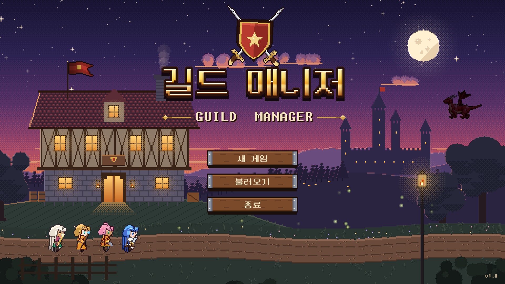
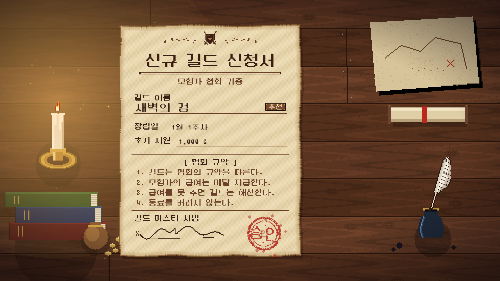
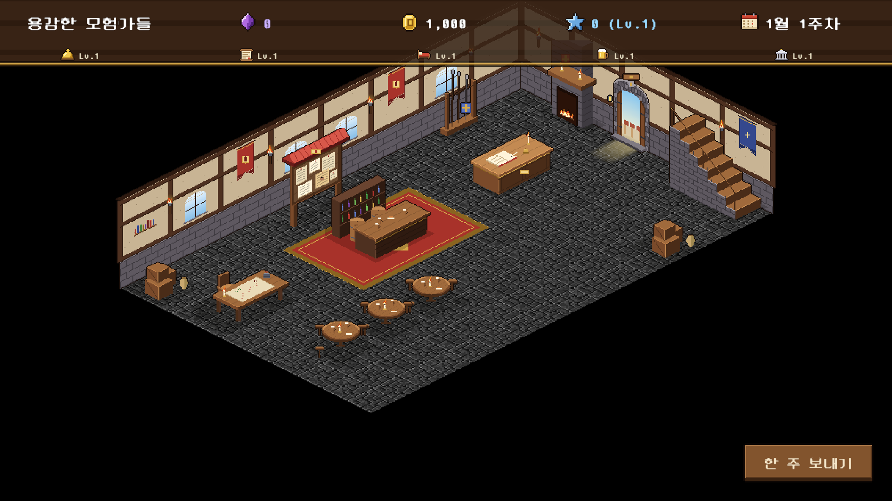
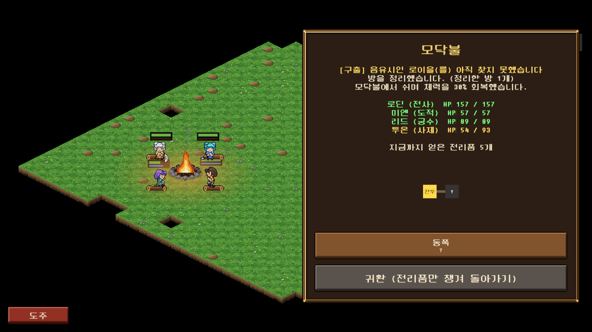
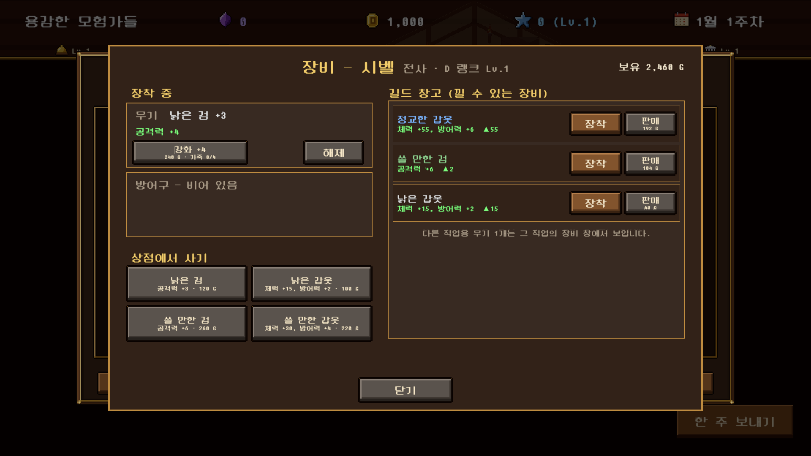
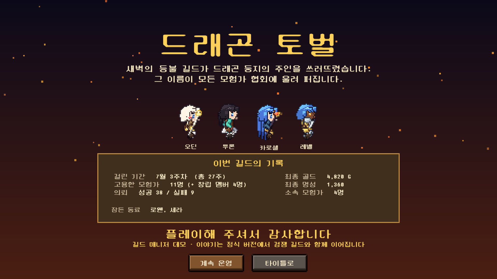

# 길드 매니저 (Guild Manager)

> 모험가 길드를 운영하는 2D 픽셀 아트 경영 + 자동 전투 RPG — Unity 6 / C#



## ▶ 바로 플레이

| 방법 | 링크 |
|---|---|
| **브라우저에서 바로 실행** (설치 없음, PC 크롬·엣지 권장) | **https://eunyim.github.io/GuildManager-V2/** |
| Windows 실행 파일 (압축 해제 후 `GuildManager.exe`) | [GuildManager-Windows.zip](https://eunyim.github.io/GuildManager-V2/GuildManager-Windows.zip) |

> 첫 로딩에 수십 초 걸릴 수 있습니다. 브라우저판의 저장 데이터는 해당 브라우저에 보관됩니다.

성격과 관계를 가진 모험가들을 고용해 파티를 짜고, 지역별 던전으로 보내 자동 전투를 지켜보며 **"더 갈지, 돌아갈지, 도망칠지"** 를 판단합니다. 벌어 온 골드로 매달 월급을 주며 길드를 키우고, 명성을 쌓아 더 위험한 지역을 엽니다. 잘못 판단하면 모험가는 다치고, 낙오하고, 죽습니다.

- **장르**: 길드 경영 · 파티 육성 · 자동 전투(오토배틀러)
- **플랫폼**: PC (Windows), 1920×1080 기준
- **엔진**: Unity 6000.3 · 2D URP · 새 Input System · TextMeshPro
- **상태**: 데모 버전 개발 중 (데모 목표: 드래곤 처치 엔딩)
- **기획서**: [Docs/GDD.md](Docs/GDD.md) ([PDF](Docs/GDD.pdf))

---

## 스크린샷

| 길드 신청서 | 길드 회관 (로비) |
|---|---|
|  |  |
| **던전 모닥불 휴식** | **장비 · 강화** |
|  |  |



---

## 핵심 루프

```
모험가 고용 → 파티 편성·여관 방 배정 → 지역·의뢰 선택 → 던전(자동 전투)
   ↑                                                        │
   └── 한 주 보내기·월급 정산 ← 결과(골드·명성·전리품·부상) ←──┘
```

- **주 단위 경영**: 고용, 파티 편성, 시설 업그레이드, 전리품 판매, 신전·치유소, 매달 월급. 월급을 못 주면 파산(게임 오버)
- **던전**: 절차적으로 만든 개미굴 구조(4~10방), 방 종류 5가지, 방 사이 모닥불에서 진행·귀환 판단
- **위험과 대가**: 부상·요양, 도주 시 낙오 → 긴급 구출 의뢰, 사망 → 유해 수습 → 영혼석으로 부활

## 주요 시스템

| 시스템 | 내용 |
|---|---|
| 모험가 | 직업 5종(전사·마법사·궁수·도적·사제), 랭크 D~S, 잠재력, 레벨 성장 |
| 사람 | 성격 13종, 특성 12종, 트라우마·결함 9종, 관계 5종(연인·친우·의형제·라이벌·불화), 무드, 파티 케미 |
| 전투 AI | 전투 성향 5종(수호·원거리·우회·지원·돌격), 어그로, 치명타·회피, 방어력, 직업 스킬, 구멍을 피하는 A* 길찾기 |
| 콘텐츠 | 던전 지역 5곳, 적 25종 + 종족 보스 6종, 의뢰 종류 3가지(보스 토벌·재료 수급·구출) |
| 경제 | 명성 레벨로 지역 해금, 시설 5종, 여관 방 증축, 장비·강화, 동시 파견(결과만 계산) |
| 연출 | 타이틀·길드 신청서·엔딩 연출, 튜토리얼 12단계 + 상황별 도움말 20종 |

## 기술적으로 신경 쓴 점

- **로직과 표현 분리**: `Assets/Scripts/Core`는 MonoBehaviour 없는 순수 C# 규칙(40여 개 Rules 클래스), `Runtime`은 화면·입력만 담당
- **밸런스 수치 하드코딩 금지**: 경제·직업 스탯·의뢰비·장비·적 배율 등을 `[Serializable]` 설정 클래스로 빼서 인스펙터에서 조정
- **에디터 자동화**: 씬·프리팹을 손으로 고치지 않고 `Tools > …` 세팅 메뉴(에디터 스크립트)로 생성·연결해 다시 실행해도 같은 결과
- **자동 플레이 봇으로 밸런스 측정**: `Editor/TempPlaythrough.cs`가 여러 설정으로 몇 주씩 돌려 승률·사망·골드·명성을 집계 → 수치 조정의 근거
- **절차적 픽셀 아트**: 타이틀·로비·모닥불·몬스터·모험가(부위 조립식, 앉기 등 동작 포함)를 Python 생성기(`Tools/`)로 그림
- **저장/불러오기**: JSON 1슬롯, 예전 저장 파일 호환 처리

## 폴더 구조

```
Assets/Scripts/
  Core/        순수 C# 게임 규칙 (경제·전투·성격·관계·던전 구조·장비 ...)
  Runtime/     화면·연출·입력 (UI 패널, 타이틀, 엔딩, 튜토리얼)
  Managers/    GameManager, BattleManager, LobbyManager, QuestGenerator, MapGenerator
  AI/          BattleUnit(공용 전투 AI) + 아군 5종 + 적 + 투사체
Assets/Editor/ 세팅 도구(Tools > …), 자동 플레이 봇
Tools/         Python 픽셀 아트 생성기
Docs/          게임 기획서(GDD), 작업일지
```

## 실행 방법

1. Unity Hub에서 **Unity 6000.3.2f1**로 이 폴더를 엽니다.
2. `Assets/Scenes/TitleScene.unity`를 열고 Play.
3. 저장 파일 위치: `%USERPROFILE%/AppData/LocalLow/DefaultCompany/guildmanager/save.json`
4. 배포 빌드: `Tools > 빌드 > WebGL / Windows` (결과는 `Builds/`, git 제외)

## 사용한 외부 에셋

- 던전 타일: [0x72 — 16x16 DungeonTileset II](https://0x72.itch.io/dungeontileset-ii)
- 글꼴: [둥근모꼴 (DungGeunMo)](https://cactus.tistory.com/193) — SIL Open Font License
- 그 밖의 그림은 `Tools/`의 Python 생성기로 직접 만들었습니다.

## 개발

- 1인 개발 (기획·프로그래밍·아트 생성기)
- AI 코딩 도구(Claude Code)를 함께 사용했습니다. 기획 결정과 방향은 직접 정하고, 구현·검증에 활용했습니다.
